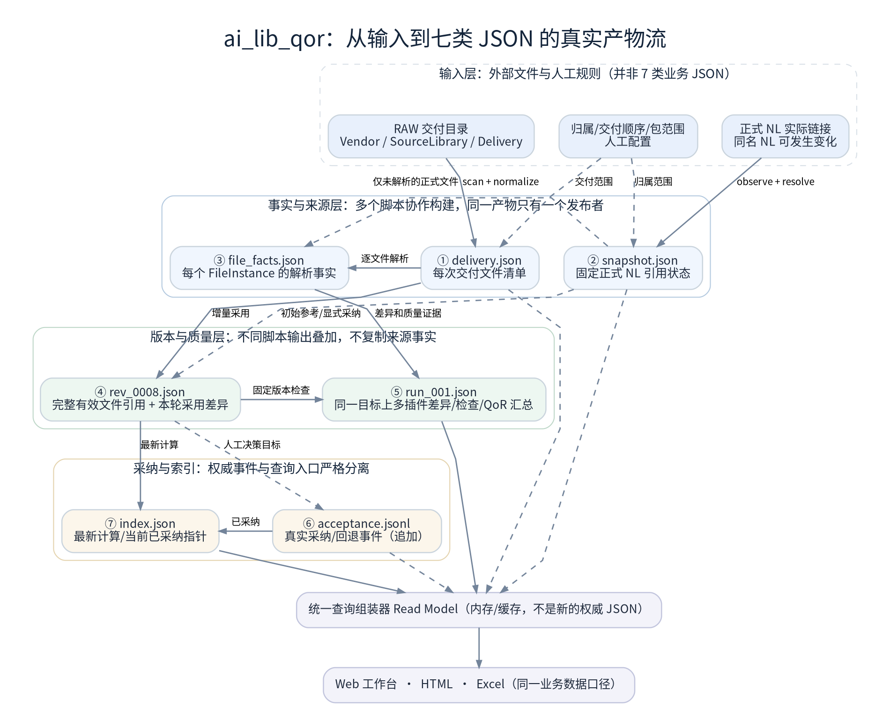
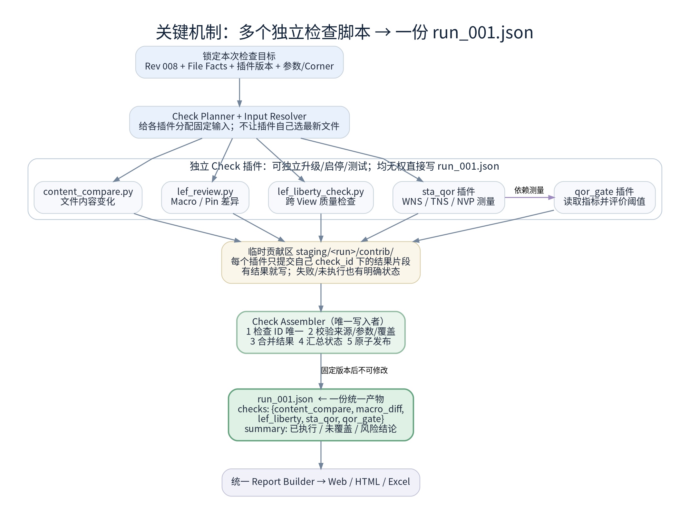
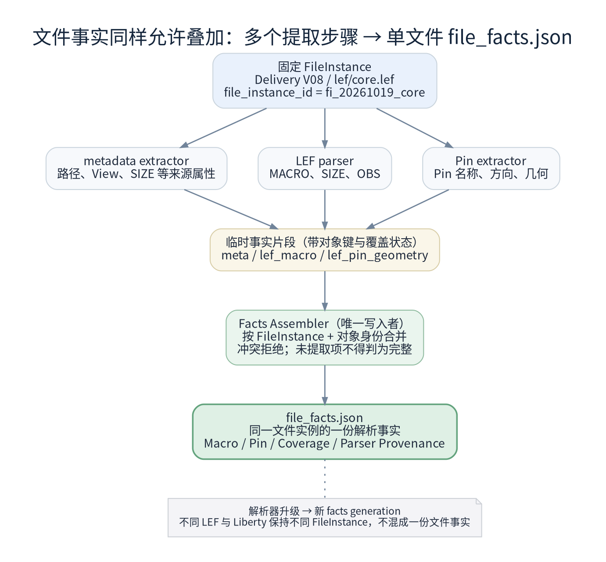
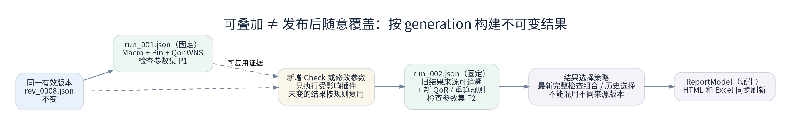
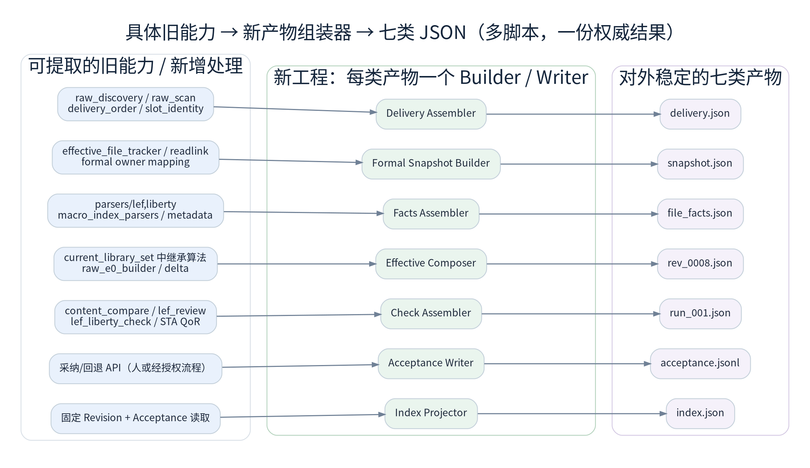

# ai_lib_qor · 以 7 类数据产物为中心的全新架构（v5 讨论稿）

> 本设计以讨论中已确定的 **7 种契约** 为约束。用户此前报告的“7 契约、13 份完整示例、116 个字段核对项、16/16 错误注入检出”属于既有审查结果；本设计不另起一套 17/34 类生产 JSON，也不声称已检查用户内网实际代码。示例中的 LEF/Macro/QoR 数值均为合成演示，**不是 EDA 实测**。

## 0. 核心判断：原 v4 还缺什么？

v4 的职责层次基本合理，但**没有把“实际中间产物”和“脚本对产物的协同贡献”作为一级设计对象**。它过多以 `parser/check/runner/report` 源码模块出发，因此容易落到“每多一个脚本，多写一个 check_results.json”的模式。

新的主线应该改为：

**原始输入 → 多个专业脚本形成事实/贡献片段 → 同一产物的 Builder 合并校验 → 7 类固定产物 → 同一 Read Model → Web/HTML/Excel**。

- 可以叠加的，是**同一个业务对象的不同领域内容或检查贡献**。
- 不可以随意改写的，是**已经发布、被其他产物引用的历史记录**。
- 每一种权威产物都只有一个**发布者（single writer）**，多个脚本是贡献者（many producers）。
- 运行中允许 `staging` 中的片段逐步出现，正式版 `run_001.json` 只在本轮收敛/验证后发布。

## 1. 最重要的五张图

### 图 1：七类产物的完整来源与消费关系



### 图 2：多个检查脚本怎样真正叠加在同一 run_001.json



### 图 3：多个文件提取步骤怎样汇总为同一文件的 file_facts.json



### 图 4：脚本新增或算法升级后，怎样按 generation 更新



### 图 5：现有脚本能力到七类产物的明确迁移映射



## 2. 七类 JSON 的真实语义和唯一发布者

| 数据契约 / 主产物 | 来源贡献脚本（示例） | 合并和唯一发布者 | 保存内容 | 主要消费者 | 更新边界 |
|---|---|---|---|---|---|
| `delivery.json` | RAW 目录发现、文件盘点、交付顺序、归属/文件槽位识别 | **Delivery Assembler** | 本次交付的真实文件、覆盖范围与已确认身份 | 文件历史、Parser、Effective | 每个交付一次固定记录；出现源原地改写需新观察记录，不能覆盖旧证据 |
| `snapshot.json` | 正式 NL readlink、引用来源匹配、固定范围盘点、归属映射 | **Formal Snapshot Builder** | 正式链接的**固定状态**及证据与覆盖范围 | Effective、正式用量与历史查询 | 同名 NL 真正状态变化才新快照；扫描相同状态不等于新快照 |
| `file_facts.json` | metadata、LEF/Liberty/CDL/Verilog Parser、Macro/Pin/Cell 属性提取 | **Facts Assembler** | **单个 FileInstance** 的解析对象、字段、覆盖与来源 | 内容比较、跨 View 检查、Macro Index | 文件或 Parser 版本变化→该文件新 facts generation；不重解析无关文件 |
| `rev_0008.json` | FileSlot 映射、继承规则、交付范围、文件选择、版本差异计算 | **Effective Composer** | 该有效版本的**全部文件来源引用**及本轮采用变化 | 检查规划、历史、HTML/Excel | 仅成员引用真实变化时新 Rev；检查脚本升级不产生 Rev |
| `run_001.json` | 文件内容比较、Macro 差异、LEF×Liberty、STA/QoR、质量阈值插件 | **Check Assembler** | **同一目标的一组插件结果**，包含覆盖、问题、指标和证据引用 | 检查详情、QoR 趋势、HTML/Excel | 检查范围/插件/参数变化→新 Run，旧 Run 不改写 |
| `acceptance.jsonl` | 人工采纳、回退或有权限的审批流程 | **Acceptance Writer** | 实际发生的采纳或回退事件（事件 ID、时间、主体、依据） | `index.json`、版本历史 | 追加，不随“新候选”和“Check PASS”自动生成 |
| `index.json` | Revision 历史、Acceptance 事件、当前正式引用索引 | **Index Projector** | 最新计算和当前采纳指针（附生成代次） | Web/CLI 的快速导航 | 可重建、可原子覆盖；**不是**历史身份 |

**现有实物**（项目截图）特别注意：`file_version_projection.py`、`formal_usage_projection.py`、`qor_projection.py`、`ip_file_history.py` 等不是第 8~11 类权威产物；它们是从上述数据构建的读模型/索引。Macro Index 也是多个 file_facts 的派生索引，不是第二份 Macro 真相。

## 3. 一个 Check 的插件结果不是一份永久业务 JSON

运行模式：

1. `CheckPlanner` 选择要运行的插件，固定 `target_ref`、已确认的 FileSlot、文件来源引用、Corner 和最终参数。选择条件来自本次 check profile，**不由插件扫描 RAW 猜最新文件**。
2. `Runner` 可以并行运行无依赖插件；有依赖的插件（如 QoR Gate 依赖 STA Measurement）等待上游输出。
3. 插件返回内存结构 `Contribution` 或把同结构写在临时 `staging/<job_id>/contrib/`；**不允许直接打开已发布 `run_001.json` 修改**。
4. `CheckAssembler` 收齐本次应执行的条目，按 `check_id` 命名空间合并，校验来源、版本、参数与覆盖状态；缺少项写 `NOT_RUN`，不可假冒 PASS。
5. 通过结构、跨对象来源与业务检查后，发布唯一的 `run_001.json`。随后 HTML、Excel 只从一个选定 Run（或明确的可追溯 Run 组合）读取。

### 3.1 同一 run_001.json 的核心结构

```json
{
  "schema_version": "check_run.v1",
  "run_id": "run_001",
  "target": {
    "kind": "effective_revision",
    "set_id": "rtavfs_primary",
    "revision_id": "rev_0008"
  },
  "input_generation": "input_gen_008",
  "checks": {
    "content_compare": { "kind": "DIFF", "execution_status": "COMPLETED", "verdict": null },
    "macro_diff": { "kind": "DIFF", "execution_status": "COMPLETED", "verdict": null },
    "lef_liberty_alignment": { "kind": "QUALITY", "execution_status": "NOT_CHECKED", "verdict": "NOT_CHECKED" },
    "sta_setup_wns": { "kind": "MEASUREMENT", "execution_status": "COMPLETED", "verdict": null },
    "qor_gate": { "kind": "EVALUATION", "execution_status": "COMPLETED", "verdict": "PASS" }
  },
  "summary": { "overall_verdict": "INCOMPLETE" }
}
```

这是**结构缩略示例**。实际完整 JSON：`examples/published_runs/run_001.json`，包含每个插件的参数、版本、指标、Macro/Pin 变化与来源证据。

**关键：文件变化 DIFF 没有 PASS/FAIL 的业务语义。** `MACRO_SIZE_CHANGED` 是差异事实，不自动等于检查失败。`sta_setup_wns` 测量也不自动等于通过；QoR Gate 依据 WNS 与阈值给出独立判定。若 LEF–Liberty 未检查，整体不能被标记为 PASS。

### 3.2 同一个 Run 中的多插件数据不会互相冲突

```text
checks: {
  content_compare:      { findings: [...], evidence_refs: [...] },
  macro_diff:           { findings: [...], evidence_refs: [...] },
  lef_liberty_alignment:{ verdict: NOT_CHECKED, coverage: ... },
  sta_setup_wns:        { metrics: [{setup_wns: -0.08 ns}], scope: tt/func/POST },
  qor_gate:             { verdict: PASS, threshold: -0.10 ns }
}
```

`check_id` 是命名空间。每个插件只拥有对应命名空间；统一摘要由 Assembler 计算，**插件不能自己发布整体 `summary`**。`check_id` 冲突要报错而不是后写覆盖先写。

### 3.3 什么时候创建 Run？是否只针对 Effective Revision？

一个检查运行的 `target.kind` 可以是 `DELIVERY`（交付预检查）或 `EFFECTIVE_REVISION`（固定有效版本检查）。这不增加新的 JSON 类别；区别只在于本次运行指向的固定目标与文件来源。

- **交付预检查**：刚收到 V08 的 `delivery.json`，可以先做“最新出现与次新出现比较”，不要求新文件已经被有效版本采用。
- **有效版本检查**：基于 Rev 008 的完整 `members`，检查“最新有效 LEF × 已确认的对应 Liberty”，不是把 RAW 历史的所有 Liberty 逐个重扫。
- 同一有效版本可以有多次 Run；每次 `run_id` 固定，报告明确选用哪一次。不能把不同输入代次的插件结果无来源说明地拼成一个 PASS。

### 3.4 第二次运行是怎样“叠加”的？

- `run_001.json`：5 个插件。WNS=-0.08 ns，阈值 -0.10 ns 时 QoR Gate PASS；LEF×Liberty 未覆盖，所以总览 INCOMPLETE。
- `run_002.json`：新增 `pin_count`，将 QoR Gate 阈值改为 -0.05 ns；内容比较、Macro 差异和 STA 实测在输入/算法/参数/环境都可确认相同时**复用其结果**；QoR Gate 重判 FAIL。
- `rev_0008.json` **不变**，`run_001.json` 也**不改写**。
- 复用的每个插件结果保留 `reused_from_run_id`，以便说明这份检查是不是本次重算。

**数据归一化要避免重复测量**：`sta_setup_wns` 保存 WNS 数值和 Corner 上下文；`qor_gate` 通过 `depends_on={check_id: sta_setup_wns, metric_name: setup_wns}` 引用该指标，只保存阈值与判定，不得再成为第二份 WNS 测量来源。

**不能复用的情况**：来源内容变了、Checker 代码/依赖版本变了、解析器覆盖不同、Corner/Mode/参数不同、检查所需环境不一致、旧结果失败/不完整；必须重新执行或明确 NOT_CHECKED。演示校验了插件版本、参数、来源引用、环境 ID，但没有核查实际 EDA 安装与文件字节。

## 4. `file_facts.json` 也应支持叠加，但有严格边界

同一个 `FileInstance = fi_20261019_core`：metadata 提取、LEF 宏解析、Pin 几何提取可以各自贡献片段，最后由 Facts Assembler 合成**同一份文件事实**。

但**不同物理文件不要合并为一份 FileFacts**：一个 LEF 和一个 Liberty 各有自己的 `file_facts.json`，跨文件的 Macro 名称/Pin 对齐应由 `lef_liberty_alignment` 检查插件完成，并写进对应的 `run_001.json`。正式 NL 的链接目标若没有匹配的 RAW Occurrence，仍应保存真实路径/固定正式来源引用，可以对该来源解析，**不能捏造一份 RAW 交付记录**。

事实叠加规则：

- `file_instance_id` 是稳定来源身份，不能只用 basename 合并。
- 同一个 Macro/Pin 以稳定对象键合并，不是拼两个重复 Macro 数组。
- 字段 ownership 明确：LEF Macro SIZE 属于 LEF parser；Corner metadata 属于 identity parser；没有明确 owner 的同字段冲突必须拒绝。
- 解析器没有提取 Pin geometry 时写 `NOT_EXTRACTED`，不能自动假定没有问题。
- Parser 改版时新建同一 FileInstance 的新事实代次，不覆盖可能已被旧报告引用的历史事实。

## 5. `delivery`、`snapshot`、`rev` 是如何由多个脚本协作的？

| 目标 JSON | 脚本 A | 脚本 B | 脚本 C | Builder 的最终责任 |
|---|---|---|---|---|
| delivery | 文件发现 | RAW 清单扫描 | 交付包范围、归属/Slot 识别 | 将一批交付固定成可追溯 Manifest；单 IP 之外的未归属文件保留 |
| snapshot | `readlink` 盘点 | 正式目标来源匹配 | IP 归属/范围标记 | 固定同名 NL 的确切文件引用状态；匹配不到 RAW 也保留链接路径 |
| file_facts | 原始文件元数据 | LEF/Liberty Parser | Macro/Pin 属性抽取 | 同一个 FileInstance 的事实分区合并，带覆盖和解析版本 |
| revision | 前版成员读取 | 新交付适用规则 | FileSlot 身份和增量差异 | 形成**完整**有效成员及变化说明，不决定是否已采纳 |
| check_run | 最新与次新文件对比 | Macro/Pin/Cross-view | STA QoR 与质量评价 | 一个 Run 记录所有计划内检查；其结果状态与覆盖独立 |
| acceptance | 授权主体的决定 | 决策依据核查 | 重放/回滚规则校验 | 只追加真实事件 |
| index | 最新计算 Rev | 有效采纳事件 | 正式 NL 当前引用 | 提供查询指针，不能替代历史事实 |

## 6. 新源码树应围绕 7 种 Builder，而不是“一个脚本一份 JSON”

```text
ai_lib_qor_next/
├── src/aiq/
│   ├── catalog/                        # Vendor / SourceLibrary / IP / FileSlot / Corner
│   │   ├── ownership.py                # 映射关系；可暂时没有 BusinessIP
│   │   └── delivery_policy.py          # FULL/PARTIAL/PATCH/UNKNOWN 的覆盖范围
│   ├── sources/
│   │   ├── raw/{discover,scan,delivery_builder}.py
│   │   └── formal/{observe,match_source,snapshot_builder}.py
│   ├── facts/
│   │   ├── parsers/{lef,liberty,cdl,verilog}.py
│   │   ├── fact_assembler.py           # 多个抽取器 → 一个 file_facts
│   │   └── macro_index.py              # 只读索引；不另造权威 Facts
│   ├── effective/
│   │   ├── slot_resolver.py
│   │   ├── inherit.py                  # 前版完整成员 + 新交付增量
│   │   ├── revision_builder.py         # 唯一写 rev_N.json
│   │   ├── acceptance_writer.py        # 唯一追加 acceptance.jsonl
│   │   └── index_projector.py          # 由已存在的 Rev 与 Acceptance 构建
│   ├── checks/
│   │   ├── plan.py                     # 本次检查 profile + 插件依赖图
│   │   ├── input_resolver.py           # 锁定 LEF/Liberty/FileSlot/Corner
│   │   ├── executor.py                 # 单个插件执行，隔离错误
│   │   ├── check_assembler.py          # 多贡献片段 -> 一个 run.json
│   │   └── plugins/{content_compare,macro_diff,lef_liberty,sta_qor,qor_gate}/
│   ├── queries/                        # file_version / formal_usage / qor_timeline / macro_index
│   ├── reporting/
│   │   ├── report_model.py             # **内存/可重建查询对象**，不新增权威 JSON
│   │   ├── html_renderer.py
│   │   └── excel_renderer.py
│   ├── api/{cli,http}.py              # Web 和 CLI 调 Application Use Case
│   ├── application/{ingest,build,check,report,accept}.py
│   └── infrastructure/{sqlite_store,artifact_store,publisher}.py
├── configs/                            # 已确认名单/Ownership/交付顺序/Check profile
└── workspace/                          # 运行数据，不与源码混在一起
```

为避免新旧 Runner 同时膨胀：`application.check()` 管用例；`checks.plan()` 管插件和文件选择；`checks.executor()` 执行单插件；`checks.check_assembler()` 只合成结果。**没有万能 `review_runner2.py`。**

## 7. 物理目录与用户浏览路径

浏览页面遵循用户确认的层级：**Vendor → SourceLibrary → BusinessIP → Effective Revision**。但跨库的一个 BusinessIP 不应复制两份 Rev；不属于任何 BusinessIP 的 SourceLibrary 仍应能维护自己的有效集合。推荐由 SQLite 索引提供浏览树，物理层按权威对象固定 ID 存储。

```text
workspace/
├── vendors/<vendor_id>/libraries/<library_id>/deliveries/<delivery_id>/delivery.json
├── formal_nl/<nl_id>/snapshots/<snapshot_id>/snapshot.json
├── file_facts/<file_instance_id>/<parse_generation>/file_facts.json
├── effective/<effective_set_id>/versions/rev_0008.json
├── effective/<effective_set_id>/acceptance.jsonl
├── effective/<effective_set_id>/index.json
├── checks/<effective_set_id>/rev_0008/run_001.json
├── staging/<job_id>/contrib/...       # 临时贡献片段，发布后可清理或归档作执行证据
├── reports/<report_generation>/{ip_overall.html,ip_overall.xlsx}
└── registry.sqlite                    # Vendor/Library/IP 关联、任务状态、快速查询索引
```

`file_facts.json` 每个物理文件实例一份，`run_001.json` 每个**检查目标 + 本轮 Profile 及运行批次**一份，`rev` 每个实际不同的完整有效文件组合一份；“7 种”说的是契约类别，不是整个系统只存在 7 个文件。

## 8. 新增脚本 / 参数 / QoR / 报告时，哪些数据变化？

| 变化事件 | delivery | snapshot | file_facts | rev | run | acceptance | index | HTML/Excel |
|---|---|---|---|---|---|---|---|---|
| 新的 RAW 交付 | 新增 | 不变 | 仅新文件解析 | 成员变才新增 | 需要的插件重新执行 | 不变 | 最新计算指针 | 仅相关对象刷新 |
| 正式 NL 链接变化 | 不变 | 状态变才新增 | 仅缺失/变化来源解析 | **不自动**修改 | 正式对照可能更新 | 不变 | 正式引用查询入口 | 正式来源对照刷新 |
| Parser 的 Pin 属性提取升级 | 不变 | 不变 | 受影响文件新一代 | 不变 | 受依赖检查重新执行 | 不变 | 最新检查入口 | 对应问题/Pin 表刷新 |
| 新增 LEF–Liberty 质量脚本 | 不变 | 不变 | 按需补解析 | 不变 | 新 Run 包含新插件 + 可复用旧结果 | 不变 | 检查运行索引 | 新增对应质量检查记录 |
| 改 STA QoR 阈值 | 不变 | 不变 | 不变 | 不变 | 只重判 Gate，真实 STA 测量可复用 | 不变 | 检查运行索引 | 改判定，不改历史测量 |
| Excel 新增 Macro Sheet | 不变 | 不变 | 不变 | 不变 | 不变 | 不变 | 不变 | 只重建报告模型与 Excel |
| 人工接受 Rev | 不变 | 不变 | 不变 | 不变 | 不必重跑 | 追加事件 | accepted 指针变 | 首页状态刷新 |

> **增量发布安全**：`staging` 中允许多个贡献者逐步写入；`Check Assembler` 单独创建正式 JSON；唯一 `CommitManager` 在数据与引用校验后发布并切换指针。若中途失败，保持旧代次可查询。不可直接 `open("run_001.json", "w")` 让多个插件先后覆盖。

## 9. 最小可执行验证（随文档附带）

演示代码：`tools/assemble_checks.py`。演示 JSON：`examples/plugin_fragments/*.json`（临时片段），`examples/published_runs/run_001.json`、`run_002.json`（固定结果）。

```bash
python tools/assemble_checks.py
cd tools && python -m unittest test_assembly -v
```

具体验证：

- 五个独立检查片段 → 一个 `run_001.json`，不产生五份业务 CheckResult JSON。
- QoR 测量与阈值评价区分；WNS=-0.08 ns、阈值 -0.10 ns 判定 PASS，但 LEF×Liberty 未检查导致整体 **INCOMPLETE**。
- 添加 `pin_count`、只改 Gate 阈值到 -0.05 ns → 新 `run_002.json`，已可靠完成的三个不变检查以 `reused_from_run_id` 复用，Gate 判 FAIL。
- 重复 ID、错误目标、无效指标声明、Gate 无测量、错误阈值判定、改变已发布 Run 结果均触发错误。

**边界**：该代码演示单写者合并、命名空间、来源一致性和检测错误的行为；尚未实现生产级文件内容稳定性验证、EDA 运行器、SQL 发布事务、代码/环境指纹缓存或真正的 RAW/LEF/Liberty 解析，不能把演示当生产完成状态。

## 10. 交给 Codex 的落地顺序

1. 固定已有 **7 类契约、13 实例、116 字段核对、16 反向测试** 为向前兼容的依据，不擅自新增第 8 类核心业务 JSON；若字段变更需逐一映射并审查。
2. 实现每种产物的唯一 Builder/Writer，先走只读、固定输入的小型端到端实例，避免新旧系统二次写同一文件。
3. 先用旧 `content_compare.py` + `lef_review.py` 的真实算法生成两份贡献，汇总到**一份** `run_001.json`；核对 Macro/Pin 变化。
4. 再接 `lef_liberty_check.py`，复用已有 Parser 和 Macro Index；缺失解析覆盖时保持 `NOT_CHECKED`，确保只针对选中最新 LEF 与匹配 Liberty 执行。
5. 引入独立 STA/QoR Measurement + Gate；确认只改阈值可以复用历史真实测量值，新增 Corner 只跑受影响范围。
6. 最后建设共同的 ReadModel → Web/HTML/Excel；相同 Run ID 的 Summary/Issue/Macro/QoR 必须严格一致，不允许 Excel 自己再次运行 Checker。
7. 增加故障恢复、并行贡献冲突、失效依赖、跨 SourceLibrary IP、RAW-only、同名 NL 快照更新等回归测试。

**结论**：先确定**数据产物与合并规则**，再确定脚本目录，而不是先决定有多少个脚本/类。这样新增脚本增加的是一个新的 `check_id` / facts extractor，不会自动增加新的业务 JSON 类型。
