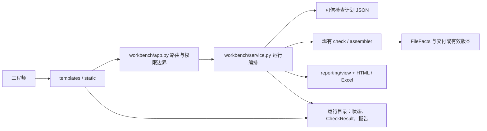

# v3 交互工作台：架构与脚本职责

## 目标与边界

将旧工作台中已具备 v3 数据与算法支撑的操作逐步迁入新代码。页面只负责操作和表达，v3 业务规则继续由已有模块维护；`src_qor` 为迁移参考，不作为运行时依赖。当前实现是单机、显式计划的检查工作台，不是旧功能的完整替代。

## 当前代码结构与接口

| 文件 | 输入 | 职责与输出 | 边界 |
|---|---|---|---|
| `src/ai_lib_qor/workbench/__main__.py` | `--plans`, `--runs`, `--port` | 启动监听 127.0.0.1 的 Flask 服务 | 不绑定外网；启动前安装 Flask |
| `workbench/app.py` | HTTP 请求、计划名 | 页面、提交、运行详情与产物下载；会话 CSRF token；只接受本机请求 | 不执行解析算法、不直接写 v3 业务状态 |
| `workbench/catalog.py` | v3 work 下已保存的有效集索引、交付与正式快照 | 只读加载和文件观察投影 | 源库文件未按 IP 过滤；不能将观察记录推断为全库最新 |
| `workbench/service.py` | 可信计划路径、运行目录 | 生成唯一运行 ID，调用已有 check/report，记录状态及错误 | 不推断文件身份、不更改计划，不进行自动采纳 |
| `workbench/templates/index.html` | 计划名称与运行历史 | 选择计划、发起检查、查看记录 | 不承载业务规则 |
| `workbench/templates/detail.html` | 运行状态与已有产物 | 显示目标、错误与下载 | 失败不伪装成功；部分文件可用于排查 |
| `workbench/static/workbench.css` | 页面结构 | 工作台样式与窄屏布局 | 不修改报告数据 |
| `tests/test_workbench.py` | 合成 v3 计划 | 覆盖运行、下载、路径与 CSRF 拒绝、失败可见 | 不等于真实 RAW 生产验收 |
| `checks/assembler.py`、`reporting/*` | 指定文件事实、版本和 CheckResult | 沿用既有检查与报告 | 适用其现有覆盖范围与证据限制 |

## 数据流和文件所有权

1. 计划 JSON 由使用者预先准备；应用只选择 `--plans` 目录中的直接 JSON 文件。其内部路径由原有 CLI 读取，按服务启动的当前目录解析，因此计划必须可信。
2. 每次运行创建 `--runs/run_<uuid>/`。`service.py` 独占写入本运行的 `status.json`，检查服务创建 `check.json`，报告服务创建 `report.html` 和 `report.xlsx`。这些运行产物互不覆盖。
3. 运行通过与报告通过不是同一概念：`SUCCEEDED` 只表示检查和报告生成过程完成；质量结论以 CheckResult 各项结果和覆盖范围为准。
4. `delivery.json`、`effective/versions/*.json`、`effective/index.json` 和 `acceptance.jsonl` 不由工作台修改；报告和检查也不会触发采纳。
5. 检查完成后再导出报告。导出失败会保留可能已生成的文件并记录失败；进程被中断可能遗留 RUNNING，当前不自动恢复。

## 旧功能迁移后续设计

| 能力 | 建议模块职责 | 前置接口及验收要求 | 状态 |
|---|---|---|---|
| 原始库发现与登记 | `catalog` 服务读取可配置根目录，生成待确认候选清单；登记调用 delivery builder | 用户确认 vendor、library、顺序、交付范围和 file_key；不可从文件名静默认定 | 设计，未实现 |
| IP / 版本浏览 | 查询服务读取 deliveries、effective index 和 versions，按对象展示 | 区分最新计算版本与已采纳版本；无法确定范围时明确未知 | 设计，未实现 |
| 文件版本矩阵 | 独立投影服务，复用 selectors | 应覆盖未解析及不完整扫描；不可把旧文件误报为最新 | 设计，未实现 |
| Formal NL 浏览 | 读取独立 `formal_nl/` 下索引和快照，明确链接来源 | 先实现并验证 Formal NL index；不复制正式库到 vendor | 设计，未实现 |
| 交互式检查配置 | 表单输出明确计划，选择目标、基线、文件事实和检查项 | 不自动把缺失事实当通过；保留人工确认与可复现计划 | 设计，未实现 |
| 后台任务 | 持久任务状态、单对象并发控制、进度与中断恢复 | 原子状态、失败诊断、重复启动及重启测试 | 设计，未实现 |
| 报告 | 基于逐版本 Run 展示范围和汇总 | 每版唯一匹配计划时可批量运行并汇总；仍需真实 RAW 与旧版 Excel 逐列对照，不能把计划范围当成全覆盖 | 部分实现，未生产验收 |
| 采纳与回滚 | 未来通过版本服务提供明确操作和审计 | 执行结果与检查结论分开，验收权限和并发 | 设计，未实现 |

## 安全与部署

此实现仅用于可信本机用户。使用随机会话密钥、CSRF token、限定计划文件名、限定下载文件名和本机监听；不能作为多用户服务器、鉴权系统或不可信 JSON 沙箱。运行输出与 RAW、Formal NL 必须分离。现有 v3 报告一致性验证和事实可信链仍有已知缺口，生产使用前需单独补齐并使用真实库验收。
