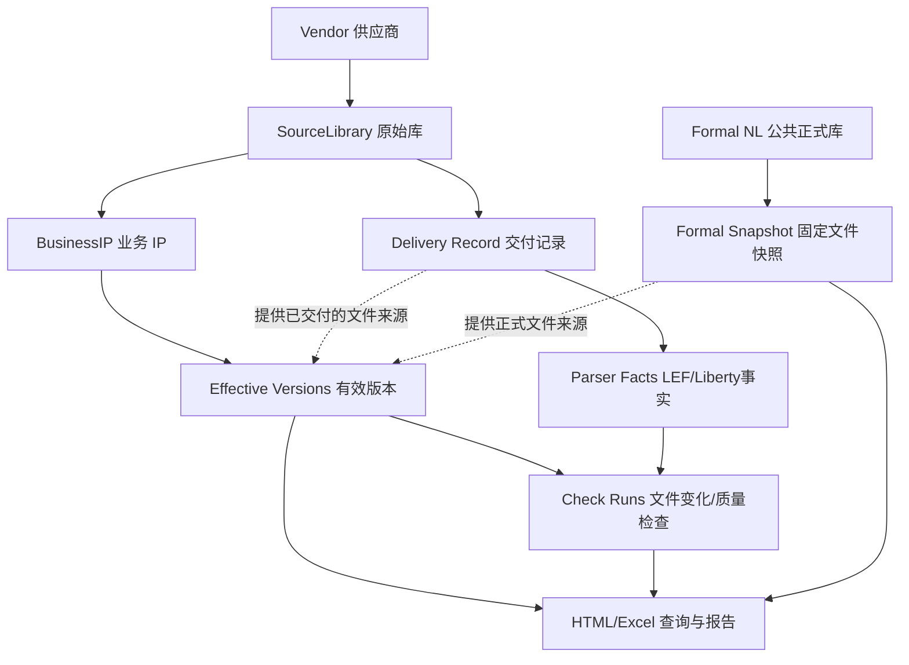
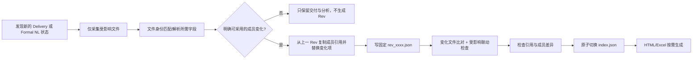

# ai_lib_qor · 文件架构与 JSON 数据契约 v3.0

> 定位：设计建议与完整**合成案例**，供 ai_lib_qor/Codex 对照实际代码落地；不是内网生产 JSON 的审计结论。日期：2026-11-13。以下示例路径 `/example/...`、对象名 `vendor_orion`、检查数值均为演示数据。
>
> 设计目标：一个 Vendor/SourceLibrary 可以持续收到多个交付；一个 BusinessIP 有可追溯的完整有效版本；正式 NL 独立变化；一次 RAW 更新只处理变化文件；用户能从 IP、交付版本、有效版本、单个文件、Macro/Pin 五个入口定位事实和变化。

## 0. 最终决定（先看这部分）

1. **主目录按管理归属**：`Vendor → SourceLibrary → BusinessIP → Effective Version`，不是按 `reviews/effective/deliveries` 做顶层横向切片。
2. **正式 NL 是公共来源**：放在 `work/formal_nl/`，其真实文件快照仅保存一份，多个 IP 通过引用关联；不能复制多个权威正式库快照。
3. **四类核心业务 JSON**：`delivery.json`、`snap_*.json`、`rev_*.json`、`run_*.json`；另有重用的 `file_facts`、轻量 `index.json`、可选 `acceptance.jsonl`。总计 **7 类契约，非 7 份文件**。
4. `rev_*.json` **包含当时全部有效文件的来源引用**，也包含相对上一版的采用变化；仅变化文件需要重新解析/比较。旧 Revision 永不改写。
5. `checks/run_*.json` 可针对 RAW 交付，亦可针对有效版本；**变化事实和检查结论**可以在同一个 Run 中，但不能等同于版本采纳决定。
6. `index.json` 是可重建的当前入口；`acceptance.jsonl` 是人工作出的采纳/回退事实。**最新计算 ≠ 当前采纳 ≠ 正式 NL 实际链接**。
7. 用户页面显示“交付文件、正式 NL、有效版本、文件变化、质量检查”，而非强迫用户理解各种 `Observation/Projection/Reference` 内部名词。
8. 不新建 `file_occurrence.json`、`file_locator.json`、`ip_formal_reference.json`、`report_model.json` 作为并列持久权威：这些需求由四类核心记录加查询索引完成。

## 1. 数据与目录框图



```text
work/
├── vendors/
│   └── <vendor_id>/
│       └── libraries/
│           └── <source_library_id>/
│               ├── deliveries/
│               │   └── <delivery_id>/
│               │       ├── delivery.json                # 每次交付一份
│               │       └── checks/                     # 交付前执行了检查时才创建
│               │           └── run_001.json
│               ├── ips/
│               │   └── <business_ip_id>/
│               │       ├── effective/
│               │       │   ├── index.json              # 当前入口，可重建
│               │       │   ├── versions/
│               │       │   │   ├── rev_0001.json        # 完整有效文件 + 本次采用变化
│               │       │   │   └── rev_0002.json
│               │       │   └── acceptance.jsonl        # 有人工采纳流程时启用
│               │       └── checks/
│               │           └── rev_0002/
│               │               ├── run_001.json        # 初次检查
│               │               └── run_002.json        # 规则升级后可重新检查
│               └── effective/                          # 仅无 BusinessIP 归属时使用
│                   └── ...与 IP/effective 同样结构
│
├── formal_nl/
│   └── <formal_nl_id>/
│       └── snapshots/
│           ├── <snapshot_id>.json
│           └── <snapshot_id>.json
│
└── file_facts/                                         # 可对接原有 Parser 输出，不强制迁移
    └── <facts_id>.json                                 # 可选择继续存在原产物目录

config/                                                   # 保留既有配置权威，不重复维护
  ip_registry.simulation.yml / roster_config.json
  library_ownership.yaml / delivery_order.yaml           # 这里仅示意已存在的配置来源
```

**为什么不再有 `primary/`？** 默认每个 BusinessIP 有一个有效文件集，`effective_set_id` 仍写在 JSON 里。当同一个 IP 真正需要第二套独立有效集合时，再引入 `effective/<set_id>/`，并将旧路径兼容迁移；不为假想的第二套提前增加目录层级。

**为什么正式 NL 不放 Vendor 下？** NL2.5.3 可同时链接多个供应商的文件；把它存到某个 Vendor 下面会制造错误归属或重复快照。BusinessIP 页面通过 `source_ref` 找到对应的正式快照文件。

**IP 跨 SourceLibrary 怎么办？** 主目录只存一份：由配置指定 `home_source_library_id`，其他库内的交付记录仍在原 Library，版本成员可以跨库引用 `source_library_id + delivery_id + file_id`。其他库不再复制 `rev_*.json`；如果将来跨 Vendor 组合成为常态，可把 IP 版本的物理归属提升为独立 `business_ips/` 存储，但仍保持 UI 的 Vendor/Library 导航。**一个权威位置是硬约束，IP 必须是 Library 的唯一孩子不是硬约束。**

**没有 BusinessIP 的库？** 直接在 `.../libraries/<lib>/effective/` 使用同一份 `effective_version` 契约，`owner_type=SOURCE_LIBRARY`，不创建虚假的 BusinessIP。

## 2. 四种核心业务记录、两个支撑数据、一个可选事件

| 数据契约 | 典型文件 | 权威内容 | 生产者 | 主要消费者 | 更新策略 |
|---|---|---|---|---|---|
| `DeliveryRecord` 交付记录 | `deliveries/<delivery_id>/delivery.json` | 本次交付到底有哪些文件、哪个交付顺序、包语义 | RAW Scanner + 已确认交付配置 | 文件定位、Effective Builder、Parser | 发现新交付时新增；旧记录固定 |
| `FormalSnapshot` 正式文件快照 | `formal_nl/<nl>/snapshots/<snap>.json` | 一次**确定状态**下 NL 实际引用的文件 | Formal NL Scanner | 正式对照、Effective Builder | 正式链接/内容状态确认发生变化才新增 |
| `EffectiveVersion` 有效版本 | `ips/<ip>/effective/versions/<rev>.json` | 该 Rev 的全部成员及本次采用变化 | Effective Builder | 时间线、单文件查询、检查、Excel | 成员集合/采用来源变化时新增 |
| `CheckResult` 检查结果 | `checks/<target>/run_*.json` | 单文件/多文件变化、Macro/Pin、质量规则、证据 | Parser + Diff + Check Engine | 版本详情、验收 Excel、HTML | 目标、检查规则或证据改变时新增 Run |
| `FileFacts` 文件解析事实 | 现有 Parser JSON 或 `file_facts/<facts_id>.json` | LEF Macro、Liberty Cell、Pin 等解析结果 | 已有 Parser | Check Engine、Diff | 新文件或解析器能力改变时更新/新建缓存 |
| `EffectiveIndex` 有效集索引 | `effective/index.json` | 最新计算 Rev、当前已采纳 Rev | Effective Builder / Acceptance Handler | 页面/CLI | 原子更新，可重建 |
| `AcceptanceEvent` 采纳事件 | `effective/acceptance.jsonl` | 人工采纳、回退决定 | 审核人员或业务流程 | Index Builder、审计 | **可选**，每次决定追加一行 |

**交付目录可以只存在 `delivery.json`**。如果从未进行入库前检查，完全不必创建 `checks/`。正式 NL 的 Snapshot 不需要按业务 IP 复制。`file_history`、`effective_timeline`、`formal_refs`、`report_model` 视图可以通过索引/SQLite 提速，但不增加第二套权威文件。

## 3. 所有 JSON 共同约定（尽量少而清楚）

### 3.1 对象身份与路径

- `vendor_id`：供应商稳定标识；不是显示名。
- `source_library_id`：RAW 来源库稳定标识。同一个 Vendor 下可能有很多库。
- `business_ip_id`：业务 IP 稳定标识。一个库可以有多个 IP，某 IP 可能跨库。
- `delivery_id`：**一次实际交付事件**的稳定标识；`supplier_version` 是供应商自报的版本文字，不能直接代替 ID。同名 V08 重交应创建新的 `delivery_id`，并显式关联交付顺序。
- `formal_nl_id`：正式发布名称，如 NL2.5.3；`formal_snapshot_id`：同一名称下的一次固定文件状态。
- `effective_set_id`：一个独立管理的有效文件集合，默认每 IP 一个；`revision_id`：该集合的有效版本。显示采用 `Rev 001`，内部采用 `rev_0001`。
- `file_key`：**同一逻辑文件位**的稳定身份，例如 `lib_rtavfs:lef:core`；需要考虑 View、Corner、Mode、Variant 的区分。它不能仅由文件基名或修改时间草率推断。若归属无法确认，`file_key=null`、`classification=UNRESOLVED`，文件仍然保留在交付清单中。
- `file_id`：在**一份交付/快照内部**的行标识；只有与其所在 `delivery_id`/`formal_snapshot_id` 组合才全局唯一。

### 3.2 唯一的文件来源引用 `source_ref`

RAW 文件：

```json
{"kind":"delivery_file","source_library_id":"lib_rtavfs","delivery_id":"dlv_20261019_001","file_id":"f001"}
```

正式文件：

```json
{"kind":"formal_file","formal_nl_id":"NL2.5.3","formal_snapshot_id":"snap_nl253_0001","file_id":"nf001"}
```

含义：**指向哪份固定记录中的哪一行文件**。不要再同时发明 `raw_ref / occurrence_ref / file_reference / formal_path_ref` 四套不兼容结构。`source_ref` 是不可变身份，不是“latest 文件路径”。

注意：引用指向历史记录，不自动保证外部真实文件在几年后仍能恢复字节；被原地覆盖时，至少要保留来源状态与已获得的解析证据，不应虚构历史内容。MVP 不要求为了此问题强制对所有文件算 Hash。

### 3.3 只保留几个易懂的状态

| 字段位置 | 值 | 含义 |
|---|---|---|
| Delivery `package_mode` | `FULL / INCREMENTAL / PATCH / UNKNOWN` | 供应商交付包语义，只有覆盖范围明确才可以据此推断完整替换；MVP 删除只认明确声明 |
| Delivery 文件 `classification` | `RESOLVED / UNRESOLVED` | 是否确定它是哪个逻辑文件位，未知不能自动加入有效版本 |
| Formal 文件 `source_match` | `MATCHED_RAW / UNMATCHED / NOT_ATTEMPTED` | 能否找到 RAW 交付对应来源；**UNMATCHED 仍可保留正式路径** |
| Parser `parse_status` | `COMPLETE / PARTIAL / FAILED` | **仅对 `covered_sections` 声明的提取范围而言** |
| Check `content_status` | `CHANGED / UNCHANGED / UNKNOWN / NOT_CHECKED` | 文件内容变化的证据结论，不能从不同交付路径自动推导 |
| Check `result` | `PASS / FAIL / INCONCLUSIVE / NOT_RUN` | 质量检查结论，与版本是否被采纳不同 |

无“总状态”字段把 `READY/PRESENT/PASS/ACCEPTED` 混在一起。需要 UI 总结时从这些独立状态计算。

## 4. JSON-01：交付记录 `delivery.json`

**存储粒度**：每个 RAW 交付**一份**。例如 V08 的一个交付包下，`files[]` 可包含很多 LEF/Liberty/Verilog/CDL，而非每个物理文件一份 Delivery JSON。

**消费者**：最新/次新文件定位、同文件历史、原始文件解析、构建候选有效版本、交付前检查。

| 字段 | 必需 | 类型 | 含义与审查要点 |
|---|---|---|---|
| `schema_version` | 是 | string | `delivery_record.v1`；解析契约版本 |
| `delivery_id` | 是 | string | 单次交付唯一；不得简单等于供应商的 V08 |
| `vendor_id` | 是 | string | 可解析回 Vendor 登记 |
| `source_library_id` | 是 | string | 可解析回 SourceLibrary 登记 |
| `supplier_version` | 是 | string | 原始供应商版本号，原样展示 |
| `delivery_order` | 是 | integer | 此库内的交付顺序；优先使用已确认的 `delivery_order.yaml`，不能仅按字符串版本或文件 mtime 排序 |
| `received_at` | 是 | ISO 时间 | 交付被接收时间，不等于文件修改时间 |
| `source_root` | 是 | path string | 该交付的只读来源路径；不得依赖目前仍存在来证明历史内容可读 |
| `package_mode` | 是 | enum | FULL/INCREMENTAL/PATCH/UNKNOWN |
| `package_scope.file_keys[]` | 是 | array | 已声明的交付覆盖范围（本例用明确的逻辑文件位）；复杂真实包可由现有配置进一步限定 View/Corner/Mode |
| `package_scope.scope_confirmed` | 是 | boolean | 是否人工/来源确认覆盖范围；未知时不能推断隐式删除 |
| `explicit_removed_file_keys[]` | 是 | array | 供应商明确声明移除的文件位，默认为空；不要由“包里缺失”自动推断 |
| `files[]` | 是 | array | 本次**实际出现**的文件记录 |
| `files[].file_id` | 是 | string | 本交付中的文件行 ID |
| `files[].file_key` | 是 | string/null | 跨多次交付关联同一个逻辑文件位；未知为 null |
| `files[].classification` | 是 | enum | RESOLVED/UNRESOLVED；不确定不自动采用 |
| `files[].relative_path` | 是 | string | 相对 `source_root` 的真实文件路径，保留实际名字 |
| `files[].view` | 是 | enum | LEF/LIBERTY/VERILOG/CDL/SDC/UPF/CPF/SPEF/DB/GDS/OTHER |
| `files[].corner` | 是 | string/null | corner 可解析时写值；不适用的视图为 null |
| `files[].mode` | 是 | string/null | func/scan 等，未知或不适用为 null |

**审查结果**：① 不要再长期保存一份与 `files[]` 重复、可独立修改的 `FileOccurrence` 事实表；File History 应从所有 Delivery 的 `files[]` 建索引。② 如果同名交付内有多组 Corner/Mode，要使用不同 `file_key`。③ `FULL` 仅指**已确认覆盖范围**，不自动等同于替换所有历史 View。④ 同名 V08 被重新发布可以新增 delivery 事件，不改写旧记录。

**增量时机**：新 `delivery_id` 到来才新增；日常不扫描旧交付的全部内容。历史目录可定期核对，发现原路径被覆盖时应产生异常记录或更新证据说明，而不是静默改掉旧 Inventory。

## 5. JSON-02：正式文件快照 `<snapshot_id>.json`

**存储粒度**：一份 Formal NL 在一个确认状态下的一套**完整范围内**实际链接文件。`NL2.5.3` 可有 snap_0001、snap_0002，但如果重复盘点得到同一状态，不需要新增一份相同 Snapshot。

| 字段 | 必需 | 类型 | 含义与审查要点 |
|---|---|---|---|
| `schema_version` | 是 | string | `formal_snapshot.v1` |
| `formal_nl_id` | 是 | string | NL 标签，不能作为唯一时间状态身份 |
| `formal_snapshot_id` | 是 | string | 固定状态 ID，历史版本引用它 |
| `previous_snapshot_id` | 是 | string/null | 上一次不同的固定状态；首次为 null |
| `observed_at` | 是 | ISO 时间 | 本次盘点时刻 |
| `source_root` | 是 | string | 正式 NL 根路径 |
| `coverage` | 是 | enum | COMPLETE_IN_SCOPE/PARTIAL/UNKNOWN，不能把某个 IP 完整误报为整个 NL 完整 |
| `scope.source_library_ids[]` | 是 | array | 此 Snapshot 统计了哪些来源库，或实际适用的已定义范围 |
| `scope.views[]` | 是 | array | 覆盖的视图；可为空但不能同时声称无依据的完全覆盖 |
| `scope.note` | 是 | string | 给人看的范围文字，防止误会“全部 NL 完整” |
| `linked_files[]` | 是 | array | 本次状态实际链接的文件集合 |
| `linked_files[].file_id` | 是 | string | 固定快照内文件行 ID |
| `linked_files[].file_key` | 是 | string/null | 归属明确的逻辑文件位 |
| `linked_files[].link_path` | 是 | string | 相对正式 NL 根的链接位置 |
| `linked_files[].resolved_path` | 是 | string | 扫描当时所解析的实际目标路径 |
| `linked_files[].source_match` | 是 | enum | 是否已匹配 RAW 文件来源 |
| `linked_files[].source_ref` | 是 | object/null | 能匹配时引用对应 `delivery_file`；未知时 null，不得编造交付记录 |

**审查结果**：① 不能在 `effective/` 中把 `formal_nl/overview/latest.json` 作为历史基线——只能引用固定 `formal_snapshot_id`。② 对正式 NL 同名更新，先比对链接目标/已知事实，真正不同才生成新快照。③ 如果正式 NL 指向未纳入 RAW 登记的文件，也能存真实 `resolved_path` 和 `UNMATCHED`。④ 若实体文件原地覆盖，仅比较链接字符串不能证明内容未变。

**增量时机**：正式 NL 盘点时与上一个固定 Snapshot 做变化检测；仅在可信范围内发生变化时新增 Snapshot。与 IP 的关系由现有 `library_ownership.yaml` 查询生成，不另保存一套权威 `ip_formal_reference.json`。

## 6. JSON-03：有效版本 `rev_0002.json`

**存储粒度**：一份有效文件集的一次完整文件成员状态。`members[]` 是本次 Rev 所有文件；`changes[]` 仅记录相对前驱 Rev 哪些文件位采用来源改变；**改变文件来源不必然意味着 Macro 内容改变**。

| 字段 | 必需 | 类型 | 含义与审查要点 |
|---|---|---|---|
| `schema_version` | 是 | string | `effective_version.v1` |
| `effective_set_id` | 是 | string | 有效文件集标识；默认一个 IP 一套 |
| `owner.owner_type` | 是 | enum | BUSINESS_IP 或 SOURCE_LIBRARY |
| `owner.owner_id` | 是 | string | 对应 IP ID 或无 IP 的来源库 ID |
| `owner.home_source_library_id` | 是 | string | 唯一权威文件存放位置的来源库 |
| `revision_id` | 是 | string | `rev_0001`、`rev_0002`，只在当前 Effective Set 内有序 |
| `parent_revision_id` | 是 | string/null | 继承的上一个 Rev，初次构建可为 null |
| `created_at` | 是 | ISO 时间 | 有效版本被计算并固定的时间 |
| `reason.kind` | 是 | enum | FORMAL_BASELINE / RAW_DELIVERY / FORMAL_ADOPTION / MANUAL_CORRECTION / IMPORT_BASELINE |
| `reason.ref_id` | 是 | string | 本次主要触发来源的固定 ID，不能引用 latest 指针 |
| `members[]` | 是 | array | **完整**有效文件成员集合，不只本次变更文件 |
| `members[].file_key` | 是 | string | 不允许重复；同时引用相同文件位不同来源时属于冲突，需先解决 |
| `members[].source_ref` | 是 | object | 这个文件位最终选用的 RAW 或正式来源 |
| `changes[]` | 是 | array | 与前驱 Rev 的文件成员差异，**不是 Macro/PIN 语义差异** |
| `changes[].file_key` | 是 | string | 哪个逻辑文件位发生采用变化 |
| `changes[].action` | 是 | enum | ADDED / REPLACED / REMOVED |
| `changes[].old_source_ref` | 是 | object/null | 旧版选用的来源；新增文件为 null |
| `changes[].new_source_ref` | 是 | object/null | 新版选用的来源；移除文件为 null |

**审查结果**：① `members` 与 `changes` 表面重复，但职责不同：前者为**独立还原任意历史版本**，后者用于**增量变化明细**。两者必须通过差异校验自动核对，不允许分别手工编辑。② 不存 `status: ACCEPTED`：采纳属于后续事件，不得回头改写 `rev_*.json`。③ 新交付只是候选来源，只有选择了文件并改变了 `members` 才生成新 Rev。④ 没有正式 NL 时，可以从 RAW 第一批已确认归属文件创建初始 Rev；待正式 NL 后续出现时不删除旧历史。⑤ 初始 Rev 的 `changes` 对所有文件记 ADDED，这是相对空集合的结构化表达，不是“供应商本次新增了全部物理文件”。

**增量时机**：从上一 Rev 加载完整 `members`，只对新交付范围内那些有明确归属的文件位替换来源，保留其余成员，计算准确差异，再写新文件。若变化为零则不新增 Rev。新版本固定后不再修改，采纳可以稍后发生。

## 7. JSON-04：检查结果 `run_001.json`

**存储粒度**：一次规则版本下针对一次明确**检查目标**的执行结果。目标可以是交付（入库前）或有效版本（入库后）。这是原 `review_result.json` 中有客观证据的部分；不包含采纳决策。

| 字段 | 必需 | 类型 | 含义与审查要点 |
|---|---|---|---|
| `schema_version` | 是 | string | `check_result.v1` |
| `check_run_id` | 是 | string | 在目标目录下唯一，允许 `run_001`、`run_002` 重跑 |
| `target.kind` | 是 | enum | `RAW_DELIVERY` / `EFFECTIVE_REVISION` |
| `target.id` | 是 | string | 所检查的交付 ID 或 Rev ID |
| `baseline.kind` | 是 | enum/null | 旧交付或旧 Rev，与 target 同类型；不需要比较时 baseline 为 null |
| `baseline.id` | 是 | string/null | 前一次选定的比较目标 ID |
| `effective_set_id` | 是 | string/null | 有效版本检查时必填；交付前检查可为 null |
| `run_at` | 是 | ISO 时间 | 本次检查实际执行时间 |
| `ruleset_id` | 是 | string | 使用的规则版本；换规则可以重跑同一个 Rev |
| `file_changes[]` | 是 | array | 文件层来源变化、内容变化结论 |
| `file_changes[].file_key` | 是 | string | 哪个逻辑文件位 |
| `file_changes[].old_source_ref` | 是 | object/null | 比较前来源；引用旧交付或旧 Rev 的文件成员 |
| `file_changes[].new_source_ref` | 是 | object/null | 比较后来源 |
| `file_changes[].source_changed` | 是 | bool | 两份来源引用是否不同（不等于内容变化） |
| `file_changes[].content_status` | 是 | enum | CHANGED/UNCHANGED/UNKNOWN/NOT_CHECKED |
| `file_changes[].object_changes[]` | 是 | array | 例如 MACRO SIZE、PIN 名称/方向、Cell 属性变化；只有查明内容差异时才填 |
| `object_changes[].object_type` | 是 | enum | MACRO/PIN/CELL/ATTRIBUTE/OTHER |
| `object_changes[].object_name` | 是 | string | 精确对象名，如 `MAC_A` 或 `MAC_A/C` |
| `object_changes[].attribute` | 是 | string | SIZE/PRESENCE/DIRECTION/... |
| `object_changes[].old_value/new_value` | 是 | JSON value | 差异两侧值，值类型依赖属性；不能用无说明的摘要代替 |
| `object_changes[].unit` | 是 | string/null | SIZE 用 um 等，布尔存在性为 null |
| `object_changes[].facts_refs[]` | 是 | array | 对应 Parser 事实 ID，能复核结果 |
| `quality_checks[]` | 是 | array | 具体质量规则及结果；没有执行可以为空 |
| `quality_checks[].check_id` | 是 | string | 例如 `LEF_LIBERTY_PIN_MATCH` |
| `quality_checks[].scope_file_keys[]` | 是 | array | 本次检查的相关文件范围 |
| `quality_checks[].result` | 是 | enum | PASS/FAIL/INCONCLUSIVE/NOT_RUN |
| `quality_checks[].coverage` | 是 | enum | COMPLETE/PARTIAL/UNKNOWN；PASS 不能在证据不足时给出 |
| `quality_checks[].facts_refs[]` | 是 | array | 此质量检查实际消费的解析证据 |
| `quality_checks[].detail` | 是 | string | 面向使用者的一句解释，注明排除项 |
| `summary` | 是 | object | 本 Run 的简单计数：文件来源更新数、已证实内容变化数、失败数、不确定数 |
| `evidence_note` | 是 | string | 本次证据范围和局限，例如只检查 Pin，不含时序弧 |

**审查结果**：① RAW 两次出现比较时，`source_changed=true`，不能被写成“已进入有效版本 REPLACED”。② 有了来源差异，不代表语义内容改变；必须保持 `UNKNOWN/NOT_CHECKED` 直到实际比较。③ `file_changes` 是文件/对象变化事实；`quality_checks` 是质量结论；可以同一 JSON 但不能混为一个 PASS。④ 全量 Macro/Pin 列表来自 `FileFacts`，不是在每次 Check 中复制整份解析结果。⑤ 一次规则更新可以只新增 `run_002.json`，不新建有效版本。

**增量时机**：本次只比较变化的文件；如 LEF 更新，需要执行依赖当前最新有效 Liberty 的跨 View 检查；即使 Liberty 本身未变化，也可能作为检查依赖被读取，但不需要重新解析。

## 8. JSON-05：文件解析事实 `file_facts/<facts_id>.json`（适配已有 Parser）

用户关心 Macro，不能只留下一个 `macro_count`：必须能还原 Macro 的名字、SIZE、Pin 名称、方向和可比对属性。但也不能强迫所有 View 使用一套 LEF 专用 `macros[]` 结构。

| 字段 | 必需 | 类型 | 含义与审查要点 |
|---|---|---|---|
| `schema_version` | 是 | string | 本文示例适配层为 `file_facts.v1`，实际可以保留现有语义事实模型 |
| `facts_id` | 是 | string | 单次解析事实记录 ID；Check 可复用它 |
| `source_ref` | 是 | object | 哪份 RAW 或正式来源对应这份事实 |
| `view` | 是 | enum | 示例 LEF / LIBERTY；其他 View 沿用各自既有 Parser |
| `parser.name` / `parser.version` | 是 | string | 解析器身份及版本，规则升级可触发重解析 |
| `parse_status` | 是 | enum | COMPLETE/PARTIAL/FAILED，但限定在 `covered_sections` 已声明的能力范围 |
| `covered_sections[]` | 是 | array | 例如 MACRO_SIZE、PIN_NAME、PIN_DIRECTION；没有列的内容不宣称被解析 |
| `units` | 是 | object | 例如 LEF 长度 um、Liberty time ns/capacitance pf；需由解析器证明并归一化 |
| `objects.macros[]` | LEF | array | Macro 名称、SIZE、PINS；必要时从既有事实补充 ORIGIN/SYMMETRY/PG/OBS 等 |
| `objects.macros[].name` | LEF | string | Macro 唯一名（文件内部范围） |
| `objects.macros[].size_um` | LEF | number[2] | 尺寸，统一 um；示例只包含明确已解析的属性 |
| `objects.macros[].pins[].name` | LEF | string | Pin 名称（可扩展多个 PORT） |
| `objects.macros[].pins[].direction` | LEF | string | 方向；不得用默认值填补缺失字段 |
| `objects.cells[]` | Liberty | array | Liberty Cell 名称及属性 |
| `objects.cells[].name` | Liberty | string | Cell 名称，对应 Macro 需通过匹配规则比较 |
| `objects.cells[].pins[].name/direction` | Liberty | string | Cell 信号 Pin；PG Pin、Timing Arc 应由更完整解析范围承载 |

**审查结果**：① 不改造所有现有 Parser 输出，仅在统一 Check 需要时对接适配器。② `COMPLETE` 不代表整个 Liberty 文法、所有 Timing Arc 都已读完，而是指定 `covered_sections` 完整。③ LEF Pin 的 DIRECTION 与 Liberty 的 input/output 大小写、PG Pin 差异等，需要显式规则规范化。④ 不能只凭文件名相同断定 Macro/Cell 兼容；应按对象名和检查范围关联。

## 9. JSON-06：有效集索引 `effective/index.json`

| 字段 | 必需 | 类型 | 含义与审查要点 |
|---|---|---|---|
| `schema_version` | 是 | string | `effective_index.v1` |
| `effective_set_id` | 是 | string | 该索引属于哪套有效文件集合 |
| `owner.owner_type / owner.owner_id` | 是 | enum/string | 业务 IP 或无归属 SourceLibrary |
| `owner.home_source_library_id` | 是 | string | 权威 Rev 的唯一保存位置 |
| `latest_calculated_revision` | 是 | string/null | 当前最新**计算成功并发布**的 Rev |
| `current_accepted_revision` | 是 | string/null | 当前已采纳 Rev；可落后于最新计算，未启用采纳时为 null |
| `updated_at` | 是 | ISO 时间 | 最近一次索引切换时间 |

**审查结果**：只有两个版本指针，不额外复制全部历史文件列表，也不把 current_accepted 默认为 latest_calculated。索引损坏时可从 `versions/` 与采纳事件重建。每次发布以临时文件写完校验后原子替换。

## 10. JSONL-07：采纳记录 `acceptance.jsonl`（可选）

每行是**一个独立合法 JSON 对象**，文件整体不是单个 JSON；使用 JSONL 是为了只追加、保留历史，防止每次采纳重写整份大数组。

| 字段 | 必需 | 类型 | 含义与审查要点 |
|---|---|---|---|
| `schema_version` | 是 | string | `acceptance_event.v1` |
| `event_id` | 是 | string | 采纳事件唯一 ID |
| `effective_set_id` | 是 | string | 被决定的有效文件集 |
| `action` | 是 | enum | ACCEPT/ROLLBACK/REVOKE；对应界面“采用/回退/撤销采用” |
| `revision_id` | 是 | string | 作用于哪个固定 Rev |
| `acted_at` | 是 | ISO 时间 | 决策发生时间 |
| `actor` | 是 | string | 作出决策的责任人/角色 |
| `reason` | 是 | string | 业务理由，不是 Parser 检查状态 |

**审查结果**：如果没有真实采纳动作，不必生成虚假的 `acceptance.jsonl`；此时 `current_accepted_revision=null`。如果有采纳，Index 的当前指针必须根据事件计算，不允许绕过决策日志单独改写。撤销（REVOKE）表示撤销当前采纳，不等价于自动回到上一版；如果业务需要明确回退，使用 ROLLBACK 并指出目标 Rev。

## 11. 单文件、Macro 和多次增量：如何查询而不新增事实表？

以逻辑文件位 `lib_rtavfs:lef:core` 为例：

| 问题 | 查询方式 | 结果落在哪些业务对象？ |
|---|---|---|
| 最新一次出现在哪次交付？ | 按 `file_key` 查询各 Delivery 的 `files[]`，由 `delivery_order` 排序 | V08 / `dlv_20261019_001` |
| 上次出现是哪次？ | 同一键回溯最近一次出现，不要求连续交付 | V07 / `dlv_20260907_001` |
| 最新有效版本采用哪个文件？ | 查 `effective/index.json` → Rev 的 `members[file_key]` | rev_0002 → V08 来源 |
| 当前已采纳版本采用哪个文件？ | 查 `current_accepted_revision` → `members` | rev_0001 → 正式 snap_0001 的文件 |
| 正式 NL 目前实际链接哪个文件？ | 最新确认 Formal Snapshot 的 `linked_files[file_key]` | snap_0002 → 仍为 V07 的 core.lef |
| Macro SIZE/Pin 改了什么？ | 查两个来源对应的 `FileFacts`，读取本次 Check 的 object_changes | MAC_A: SIZE [120,80]→[124,80]，新增 Pin C |
| 最近 5 次更新谱系？ | 合并 Delivery 中此 file_key 的出现事件和 Rev 的 `changes`，按时间展示两条线 | 交付出现/有效采用两类事件，不能合并成一次事件 |

可生成只读 `file_locator` 索引或 SQLite 索引提高查询速度，但它们不是新的权威记录，不必让员工理解 `file_occurrence` 与 `projection` 两个抽象名词。

## 12. 日常增量更新流程及操作边界



### 12.1 更新表

| 触发事件 | 写入 | 复用不动 | 是否自动改变已采纳版本？ |
|---|---|---|---|
| 新增 RAW V08 | 新 `delivery.json`，必要时新 `file_facts`、交付前 `checks` | 历史 Delivery、Formal Snapshot、旧 Rev | 否 |
| 选定 V08 两个文件进入有效集 | 新 `rev_0002.json`，只计算被替换项，后续检查新增 Run | 旧 Rev、其余文件事实 | 否 |
| NL2.5.3 链接更新 | 新的 Formal Snapshot（状态确实改变时） | 已存在 Rev 和已接受指针 | 否 |
| LEF–Liberty 规则升级 | 对目标 Rev 新增 `run_002.json` | 同一个 Rev 和未变化 Parser Facts | 否 |
| 人工接受 Rev 002 | 追加 JSONL + 原子刷新 index | 全部 Rev 和检查结果 | **是** |
| 扫描未发现变化 | 可只记工具日志 | 所有业务 JSON | 否 |

### 12.2 更新失败与去重（MVP 必需三条）

1. **幂等**：以 `delivery_id`、`formal_snapshot_id`、`effective_set_id+revision_id` 作为稳定身份；同一次处理重跑不得产生重复历史。
2. **先写后发布**：新 Revision、Check 写在可校验的临时位置，成功后才更新对外的 index。发布失败仍可以打开上一个有效版本。
3. **有边界的重算**：只重跑变化文件及依赖它的检查；例如新 LEF 要读现有有效 Liberty 的 Pin 事实，但不必重解析所有 Liberty。

不要求第一版建设事件总线、多个消息队列、复杂 DAG 引擎或分布式事务。简单 Python Runner + 文件清单/SQLite 小索引 + 原子文件替换足以实现 MVP。

### 12.3 不允许的五类自动推断

- 新交付目录出现一个 `core.lef` ≠ 已经被有效版本采用。
- RAW 来源路径变化 ≠ Macro/Pin 内容已变化。
- 从 FULL 包中没看到某个文件 ≠ 可以在未知覆盖范围下自动删除该文件。
- 新的正式快照出现 ≠ 当前采纳有效版本要立即重建。
- 一次 Pin 检查 PASS ≠ 整个 Library 或整个 Liberty 的 QoR 全部通过。

## 13. 设计级验收清单

| ID | 检查项目 | 合格要求 |
|---|---|---|
| A01 | 同一个文件跳过多个交付 | 按出现历史找到最新/次新，不错误地认为缺席代表删除 |
| A02 | V08 只更新两文件 | 仅新建交付并增量解析两文件；新 Rev 继承其他成员 |
| A03 | 完整 Rev 可还原 | Rev N 的 `members` 与其父 Rev+`changes` 一致 |
| A04 | 文件来源能追溯 | 每个 `source_ref` 指向存在的固定交付/正式文件行 |
| A05 | 正式 NL 同名更新 | NL 标签相同但 Snapshot ID 可更新；旧 Rev 引用不漂移 |
| A06 | 新正式 NL 不自动采纳 | current_accepted 不跟随 formal 或 latest_calculated 自动变化 |
| A07 | 未归属 RAW 文件 | 仍保留交付事实，不能自动进入 Effective Version |
| A08 | 未匹配 RAW 的正式文件 | 记录真实 link_path/resolved_path 与 UNMATCHED，不虚构 RAW |
| A09 | 来源替换但内容未检查 | 可标记 source_changed，content_status=UNKNOWN/NOT_CHECKED |
| A10 | Macro/Pin 差异有证据 | 使用固定 facts 引用、对象名、属性、单位和前后值 |
| A11 | 重新执行检查不产生新 Rev | 同 Rev 可 `run_002`，规则新旧检查独立留存 |
| A12 | 采纳与回退 | 只能由人工决策事件改变 accepted 指针，不重写历史版本 |
| A13 | 无 BusinessIP 的 SourceLibrary | owner=SOURCE_LIBRARY，保持独立有效文件集 |
| A14 | BusinessIP 跨 SourceLibrary | 所有成员可跨库引用，但有效版本只有一个权威保存位置 |
| A15 | 全/增量包规则 | 不因增量包遗漏删除已有有效文件，不把 UNKNOWN 当 FULL |

## 14. 与既有 ai_lib 产物的迁移对应

| 已有文件或概念 | v3.0 定位 | 需要做什么 |
|---|---|---|
| `ip_registry.simulation.yml`、`roster_config.json` | 输入登记与业务配置 | 继续读取，去除重复维护的权威字段；**不要机械地全部改成 JSON** |
| `library_ownership.yaml` | 归属权威 | 继续使用；确定 IP 的 home library 和可用文件范围 |
| `delivery_order.yaml` | 交付顺序权威 | 继续使用，填 `delivery_order` |
| `discovery/library_discovery.json`、`file_history/` | 派生查询索引 | 可作为加速缓存，不强制删除和重建 |
| `formal_nl/.../runs` | 正式 NL 盘点运行证据 | 可保留原有运行日志；确认不同状态时生成固定 Formal Snapshot |
| `formal_nl/overview/latest.json` | 方便导航的指针 | 不能作为旧 Effective Revision 的固定历史基线 |
| `effective_baseline.v1.json` | 初始基线来源 | 映射到初始 Rev 的 `reason` 与 `members`，保留旧证据供追溯 |
| `effective_timeline.v1.json` | Effective Revision 时间线查询 | 可重建，不再自成权威历史 |
| `review_result.json`、`ip_review.xlsx` | 审查/工程质量结果 | 结构化检查内容映射到 CheckResult，Excel 仍保留为交付产物 |
| `current_file_sets/latest.json` | 审查对照文件范围缓存 | 不得直接当“当前已采纳有效文件” |
| `BusinessIP_Overall_*.xlsx` | 整体报告 | 从 Revision、Checks、Formal Snapshot 组合渲染 |
| `DeliveryVersion_*.xlsx` | 每次交付报告 | 从 Delivery + RAW Checks + 相关有效更新渲染 |

**迁移顺序**：① 先在现有代码构建 Adapter，并生成上述示例等价结构；② 核对 1 个有正式 NL 的 IP 和 1 个 RAW-only 库；③ 再迁移索引读取与 HTML/Excel；④ 最后根据真实需求合并旧文件。旧数据不要直接删除，历史数据不因契约改名而失效。

## 15. 哪些没有设计进 v3.0，为什么？

- **没有独立交付版本 Excel JSON 权威**：Excel 是渲染结果，交付记录和检查结果才是来源。
- **没有每个文件一份 `file_history.json` 权威**：单文件历史由 Delivery + Revision 联合查询，必要时可生成缓存。
- **没有独立 `MacroIndex` 的第二套事实定义**：保留现有 Macro Index / Parser，Check 引用事实 ID。
- **没有把六大 View 的齐套判定做成强制阻塞**：只列出已发现 Views/Corner；是否齐套以后用独立规则配置决定。
- **没有让 QoRMeasurement 成为人人都需写的独立 JSON**：能稳定定义和复核的指标可以归入 CheckResult 或沿用现有 QoR 时间线；真正运行级 STA QoR 另按运行上下文扩展，不能把 MacroCount 冒充 PPA/QoR。
- **没有把正式 NL/有效库/RAW 三种时间线合成一条“版本号”**：三者只通过引用关联，互相独立演进。

## 16. 仍需通过真实项目验证的业务事实

这不是要求新增防御机制，而是决定下一步能否正确实现的实际输入事实：① 当前 `library_ownership.yaml` 是否能唯一确定跨库 IP 的 home；② 交付顺序是否对同名重交有明确次序；③ 当前 Parser 对 LEF Macro/Pin 与 Liberty Cell/Pin 的覆盖范围；④ 正式 NL 的链接记录是否能追溯历史；⑤ 实际 `ReviewResult` 的哪些字段可映射到 CheckResult。上述未知内容不能用合成示例宣称已解决。

**一句话总结**：**交付记录负责“出现过什么”，正式快照负责“正式用了什么”，有效版本负责“选用了什么”，检查结果负责“变了什么及是否合格”，索引负责“现在看哪一版”。** 这五句话对应新系统的主要数据职责。
