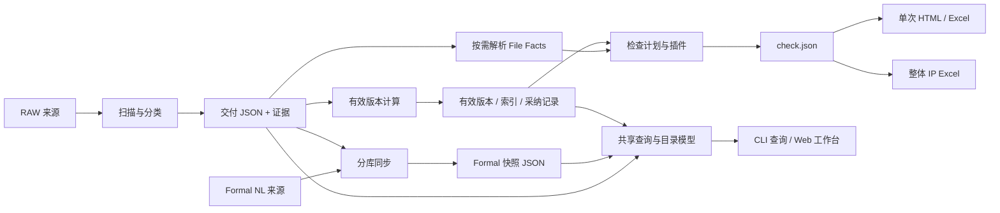

# ai_lib_qor 当前脚本与输出目录核查

核查日期：2026-11-18。范围：当前 `ai_lib_qor/src/ai_lib_qor`、`schemas/` 及已有模拟输出。本文描述已检查到的源码和样例，不将旧设计图或测试数据当成生产运行状态。`work` 和 `runs` 是配置或命令参数指定的目录，下图是结构示意，不表示项目中只有一个固定目录。

## 1. 业务主线



说明：图中是职责和数据依赖，箭头不代表每次运行都会自动完成下游全部步骤。整体检查会为选中的每个有效版本匹配检查计划并运行子任务，再汇总结果；每个版本必须恰有一个匹配计划，否则拒绝执行。解析事实和检查计划需要预先准备，不是仅有 delivery 就必定能生成报告。

## 2. 脚本职责

| 模块 / 脚本 | 输入和职责 | 主要输出 / 消费方 |
|---|---|---|
| `cli.py`、`__main__.py` | 命令入口：扫描、同步、登记、查询、解析、检查、报告和运行计划 | 调用应用服务；各命令需要显式参数 |
| `sources/source_discovery.py`、`update_scan.py` | 加载扫描配置，发现来源及版本，记录文件元数据 | 扫描观察；增量判断依据元数据，并非逐次 SHA-256 内容比较 |
| `sources/classifier_adapter.py`、`auto_ingest.py` | 分类并登记扫描发现的 RAW 文件；复用旧分类器，保留不能确认的文件 | `delivery_*.json`、`evidence_delivery_*.json`；自动登记不等于自动采纳 |
| `sources/registration.py`、`delivery_builder.py` | 人工登记及交付记录构建 | Delivery JSON |
| `sources/formal_sync.py`、`snapshot_builder.py` | 观察 Formal NL，依据来源归属生成分库快照；记录软链接文本及解析目标 | `formal_<NL>_*.json`；观察记录留在运行目录 |
| `sources/layout.py` | 安全的库路径与文件序号规则 | 供来源和版本写入复用 |
| `application/source_repository.py` | 读取现有记录，兼容历史目录及证据侧车 | 应用层统一读取，不重新扫描来源 |
| `application/catalog.py`、`library_catalog.py`、`data_query.py`、`projections.py` | 组织库、版本、Formal 和文件查询模型 | CLI 与 Web 读取模型；不把 Web 展示当作新的事实源 |
| `application/simple_sources.py` | 将已有记录投影成简化 RAW/Formal JSON，并提供 JSON 驱动的有效集合及历史计算 | `raw.simple.v1` / `formal.simple.v3` 等派生数据；当前并未全面取代版本服务 |
| `application/scans.py`、`pipeline.py`、`runs.py` | 编排扫描入库、计划检查、单次运行和整体 IP 批量运行 | 扫描日志、`check.json`、单次及整体报告 |
| `versions/service.py`、`composer.py`、`delivery_policy.py`、`slot_resolver.py` | 交付文件选择、文件位、继承与有效版本合成 | 完整有效版本及相对父版本的成员变化 |
| `versions/store.py`、`index_projector.py`、`acceptance.py`、`cli.py` | 保存版本、维护索引、记录采纳事件及版本命令 | `effective_*.json`、索引、采纳日志；可显式开启文件校验 |
| `facts/parsers.py`、`facts/rich_evidence.py`、`facts/_compat/` | 按需解析 LEF、Liberty、Verilog、CDL 等受支持内容及证据 | File Facts / 解析证据；解析覆盖范围依实现而定 |
| `checks/plan.py`、`assembler.py`、`runner.py`、`registry.py`、`selectors.py`、`plugins/` | 检查计划、输入组织及插件执行 | `check.json`；当前插件含 LEF Macro 差异与 LEF–Liberty Pin 匹配，不能据此宣称已覆盖旧系统所有检查 |
| `reporting/view.py`、`workbook_model.py`、`excel.py`、`overall_excel.py`、`html.py` | 将检查结果与可用上下文组织成展示和报告 | 单次 `report.xlsx` / `report.html`；批量 `overall.xlsx` |
| `workbench/app.py`、`__main__.py`、`templates/`、`static/`、`progress.py` | Web 路由、模板、静态资源、执行进度 | 工作台界面；运行进度是进程内状态，重启不保证保留 |
| `workbench/catalog.py`、`read_models.py`、`scans.py`、`service.py` 等 | Web 侧适配和兼容入口 | 调用应用层服务，具体依赖仍应以源码为准 |

其他代码位置：`schemas/` 定义交付、Formal、有效版本、检查等契约；`tests/` 存回归测试；`docs/` 存设计与说明。现有代码仍在部分分类/兼容路径依赖旧实现，不能说旧代码依赖已完全消除；本次没有修改旧 `lib_guard`。

## 3. 工作数据目录

```text
<work>/
├── scan_sources.json                  # RAW 来源及发现配置
├── formal_sources.json                # Formal NL 来源配置
└── libraries/
    └── <vendor>/
        └── <library>/
            ├── delivery_001.json      # 某次 RAW 交付事实
            ├── delivery_002.json
            ├── evidence_delivery_001.json  # 配套来源/分类证据
            ├── formal_NL2.5.3_001.json    # 按 NL + Vendor + 库保存的快照
            ├── formal_NL2.5.3_002.json
            ├── effective_<set>_001.json    # 一份有效版本的完整成员
            ├── effective_<set>_002.json
            ├── effective_<set>_index.json  # 最新计算、当前采纳等索引
            ├── effective_<set>_acceptance.jsonl # 采纳事件，可不存在
            └── .versions.lock         # 写入锁，可见于实际目录
```

这是当前新写入的扁平库布局；旧目录仍存在兼容读取。编号是文件命名序号，不能单凭文件名推断供应商版本的业务先后。RAW 与 Formal 分属不同事实来源，只是按库集中存储；Formal 快照中的 `link_target` 是观测时原始软链接文本，旧快照没有该字段时不能用当前链接倒填历史。

## 4. 运行记录和报表目录

```text
<runs>/
├── scans/                     # 扫描观察，按 scan_id 保存
├── classified/               # 分类结果
├── ingest/                   # 对应扫描的登记结果
├── formal_observations/      # Formal 观察及异常记录
├── run_<id>/                 # 单次检查
│   ├── status.json            # 运行状态，会更新
│   ├── input_plan.json        # 本次检查计划副本
│   ├── check.json             # 结构化检查结果
│   ├── report.html
│   └── report.xlsx
├── run_<another_id>/          # 单文件解析证据运行（按操作产生）
│   ├── status.json
│   ├── parser_evidence.json
│   └── parser_evidence.html
└── run_<batch_id>/            # 整体 IP 检查汇总
    ├── status.json
    ├── overall.json
    └── overall.xlsx
```

各文件按所执行操作生成；失败运行可能只包含部分文件。整体 IP 运行会另建每个版本的子运行目录，整体 Excel 汇总各子运行的 `check.json`。手动 `facts`、`check`、`report` CLI 可由 `--out` 等参数指定位置，不一定落在上述目录。

## 5. JSON 的生产、消费和地位

| 数据 | 主要生产者 | 主要消费者 | 定位 |
|---|---|---|---|
| Delivery + evidence | 来源扫描/登记 | 查询、有效版本、解析和报告 | 已登记的 RAW 交付事实与辅助证据 |
| Formal Snapshot | Formal 同步 | 查询、对照和报告 | 指定时刻的分库快照；版本 v2 包含软链接目标文本 |
| Effective Version | `versions` 服务 | 查询、检查和报告 | 完整有效成员与成员变更；不等于采纳 |
| Effective Index | 索引投影 | 查询和工作台 | 可重建的版本指针；最新计算与当前采纳分开 |
| Acceptance Event | `versions/acceptance.py` | 索引投影和查询 | 采纳、回退、撤销事件；并非所有库都有 |
| File Facts | `facts` | 检查和报告 | 对具体文件及覆盖范围的解析结果 |
| Check Result | 检查执行器 | 单版本和整体报告 | 某次检查的结果；报告不是权威输入 |
| `raw.simple.v1` / `formal.simple.v3` | 简化查询/导出 | 离线查询及计算 | 派生数据，不替代原始 Delivery / Formal 权威记录 |

## 6. 实际可核验样例

- [Formal 软链接与 RAW 联合模拟工作目录](../exports/formal_link_target_review_huos9l37/work/libraries/)：包括多个 Vendor／库、Delivery 和 Formal 快照；这是模拟运行样例，不是生产全量目录。
- [RAW 交付样例](../exports/formal_link_target_review_huos9l37/work/libraries/IHP/sg13g2_stdcell/delivery_005.json)、[Formal 快照样例](../exports/formal_link_target_review_huos9l37/work/libraries/IHP/sg13g2_stdcell/formal_NL2.5.3_001.json)。
- [有效版本样例目录](../exports/flat_library_review_rdyp0zdh/work/libraries/SRAM22/sram22_256x16m8w8/)：含两个有效版本、索引和模拟采纳日志；它与上面 Formal 测试不是同一轮运行。
- [Formal 简化导出样例](../exports/formal_link_target_review_huos9l37/formal_NL2.5.3_001.simple.v3.json)。

## 7. 现状边界和维护重点

1. 架构图与代码已发生变化：`architecture_navigator/architecture_model.json` 中仍包含旧路径和拟议模块，结构校验通过不代表内容事实已更新。不要把旧 HTML 作为当前目录的准确来源。
2. 交付、Formal 快照是底座；有效版本是另一份计算结果，采纳是单独事件，检查运行不会自动采纳。
3. 不确定的分类和候选文件需要保留证据；未知不能视为已确认。历史记录缺少证据时，应保持未知。
4. 简化视图和版本排序规则已在部分查询路径中实现，尚不应宣称已贯穿所有 Web、Excel 和有效版本入口。
5. 检查能力受计划、File Facts 的可用性和解析覆盖范围限制；整体报告的匹配计划缺失或重复会阻塞，不应将未检查等同通过。
6. 这次核查没有运行完整回归测试，也没有重新扫描真实 RAW/NL；样例仅证明文件存在，不能推断当前真实库已经同步。

关键证据：`src/ai_lib_qor/application/runs.py`、`sources/formal_sync.py`、`sources/auto_ingest.py`、`application/source_repository.py`、`application/data_query.py`、`application/simple_sources.py`、`versions/`、`reporting/`、`workbench/`。
