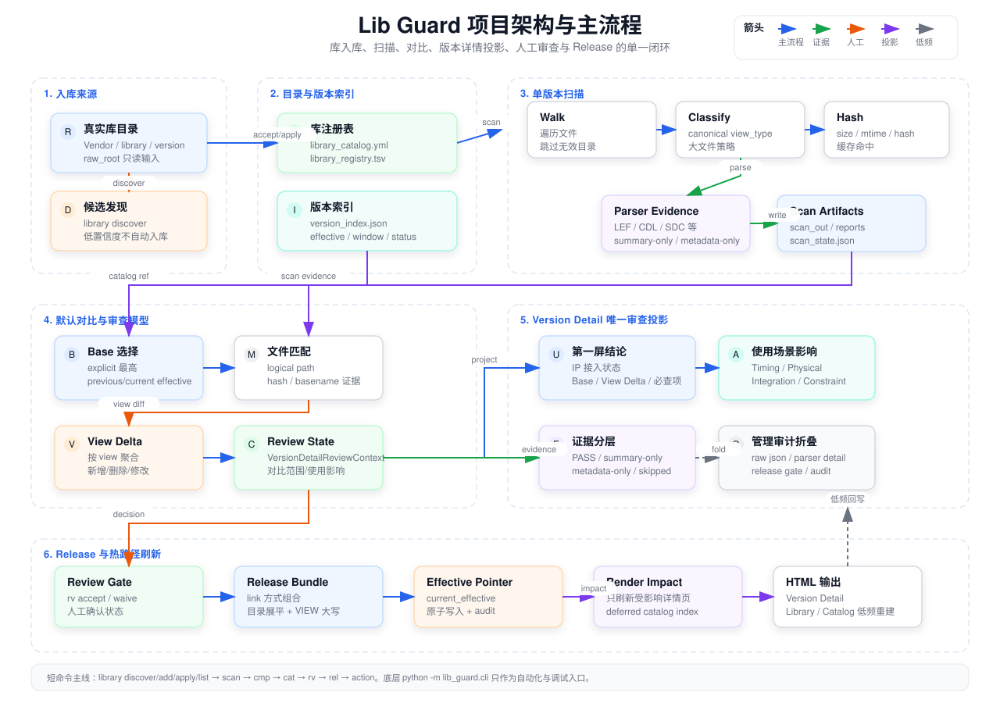

Status: current

# 架构说明

`lib_guard` 围绕审查证据组织，而不是围绕页面或命令组织。所有模块必须遵守单向数据流：

```text
配置/人工确认 -> 事实采集 -> 派生审查模型 -> HTML/TSV/JSON 投影
```

HTML、`catalog_state.json`、`manager_tasks.json` 和 `report_index.json` 是投影或索引，
不能反向驱动 scan、diff、release 或有效版判断。

Version Detail 的工程验收也分四层：Gate 1 校验上游 catalog/scan/diff/effective/window
事实，Gate 2 校验 review model，Gate 3 校验 Version Detail 投影，Gate 4 用真实桌面浏览器
走完用户路径。只有四层都通过，才能把页面标记为完整验收通过。

命令行查询当前有效版时，优先读取 `current_effective.json` 和对应
`effective_manifest.json`。`report_index.json` 只能作为报告导航索引和兼容回退，不能作为
有效版事实来源。



```text
raw delivery
  -> catalog
  -> scan
  -> parser results
  -> summary/readiness
  -> diff
  -> review gate / owner override
  -> manifest-driven symlink release
```

## 源码边界

| 责任 | 路径 |
| --- | --- |
| Catalog 状态和库清单 | `src/lib_guard/catalog/` |
| Scan inventory 和 parser | `src/lib_guard/scan/` |
| Summary/readiness 构建 | `src/lib_guard/summary/` |
| 结构化对比 | `src/lib_guard/diff/` |
| Package/effective 组合 | `src/lib_guard/package/`, `src/lib_guard/effective/` |
| Release evidence 和 link/verify | `src/lib_guard/release/` |
| Review Gate 聚合 | `src/lib_guard/review/` |
| HTML 渲染 | `src/lib_guard/render/` |
| Web 控制层 | `src/lib_guard/web/` | 只读 Catalog/runtime、受控提交动作、复用现有 Version Detail |
| 跨视图语义诊断 | `src/lib_guard/semantic/` | 从最终 Effective 文件与 Scan 证据派生，独立只读建议，不接入 Release Gate |
| CLI 入口 | `src/lib_guard/cli.py`, `src/lib_guard/short_cli.py`, `src/lib_guard/cli_commands/` |

### 跨视图语义诊断（实验性）

`effective.py` 按 source_version 精确关联 inventory 与 ParserResult；`adapters.py` 保留
LEF/Liberty/Verilog 的独立事实；`binding.py` 和 `normalize.py` 只做确认映射、唯一 exact
名称和上下文明确的总线规范化；`checks.py` 给出一致性建议及双侧属性变化。
`runner.py` 生成完整派生快照，最后原子发布 `summary.json`；`cli.py` 是独立诊断入口。

当前实施的是“稳定 Facts、按需 Model、脚本化 Rules、版本化 Results”：

| 层 | 实现 | 生命周期与责任 |
| --- | --- | --- |
| Facts | `semantic/facts.py`、`adapters.py` | 按解析输出、Parser 版本、Facts schema 及转换代码指纹共享视图原生事实；来源引用分离 |
| Model | `binding.build_effective_model()`、`profile.py` | 根据最终 Effective、所选宏/View/Corner/Mode 临时组装；不维护全局可变模型 |
| Rules | `checks.check_bindings()`、`compare_bindings()` | 显式 Python 函数；只运行已选规则；Delta 与质量状态保持独立 |
| Results | `results.py`、`runner.py` | 固定双方输入、Scope、确认映射、规则代码和 Facts 引用；完整快照确认后再切换结果指针 |

`configs/semantic_review.json` 控制检查方案和 Facts 存储位置。相同事实可被 E2/E3 和不同方案共享；
解析器或转换代码更新产生新身份，原事实文件及已完成快照不原地更新。需要保留历史诊断时，
保留快照及其共享 Facts。`load_review_snapshot()` 校验并恢复已保存的结果，不重新运行规则，
也不依赖原始扫描目录。规则或映射变化产生新 generation；复用和强制重算得到相同语义结果。

Facts 身份依据 ParserResult 内容，不会偷偷读取大型 RAW 做完整 hash，也不会把 ParserResult
指纹称为 RAW 内容验证。原始文件解析复用仍归 ScanCache；无内容 hash 的条目绑定来源路径，
有相同内容 hash 的复用条目重新绑定当前来源。此处不新增数据库、插件引擎或依赖调度图。

此模块不调用扫描、哈希、accept、release 或 HTML 工作流。旧解析器缺少完整覆盖声明，
因此真实库端口集合可为 NOT_CHECKED；不得自动升级为 PASS。当前不接入 Version Detail，
避免把未验收覆盖范围的诊断变成使用判断。验收与限制见 [语义诊断记录](superpowers/plans/2026-10-14-semantic-ir-validation.md)。

LEF-first 路径进一步将长期摘要和检查明细分开：

| 对象 | 生命周期 | 内容 |
| --- | --- | --- |
| File Facts | 共享持久证据 | Macro 名称、接口、Size/Class/Pin Count、来源身份与覆盖；不复制完整几何 |
| Macro Index | 有效组合结果内的轻量索引 | IP/Effective/确认 Variant 上下文、物理摘要、来源候选和关联状态 |
| Check Facts | 单次诊断任务 | 从已验证 ParserResult 取得 Interface、Physical、Obstruction 数据，各规则共享，不另存巨型几何模型 |
| Check Results | 不可覆盖快照 | 每条规则需要的输入、可信范围、变化摘要及源证据引用 |

实现复用 `semantic/lef_checks.py`，没有平行的 checks 目录或通用 Reader 插件框架。
`lef_basic` 只依赖 LEF，可先做 Macro 索引及 Delta，再使用已有跨视图方案。
当前已验证 RECT/PORT 分组的比较范围；复杂几何明确为 INCOMPLETE，后续扩展需要独立成熟 Reader
和新反例验收，而不是向 Macro Index 增加坐标字段。验收记录见
[Macro 与检查事实](superpowers/plans/2026-10-16-macro-check-facts.md)。

## 主流程文件地图

这一节回答“改问题时先看哪里”。`lib_guard` 的源码文件不少，但日常主流程只围绕下面几条线走。
其他文件多是支撑模块、测试或兼容层，不应该先从那里下手。

### 入口层

| 入口 | 核心文件 | 作用 | 维护原则 |
| --- | --- | --- | --- |
| 小白/日常短命令 | `src/lib_guard/short_cli.py` | 把 `lg next/scan/cmp/cat/rel` 展开成底层 CLI 命令 | 只做参数解析和命令编排，不写业务事实 |
| 短命令配置 | `src/lib_guard/short_cli_config.py` | 读取 `lib_guard.yml`、规范化 workspace 路径、生成默认配置 | 所有短命令配置路径逻辑集中在这里 |
| 全局配置中心 | `src/lib_guard/project_config.py` | scan/hash/discover/view type/Web 动作 allowlist 的默认策略 | 新策略先进入这里，再被 CLI/Web/render 引用 |
| 底层自动化 CLI | `src/lib_guard/cli.py` | `python -m lib_guard.cli ...` 的正式工程入口 | 提供稳定机器接口，不承载 UI 体验 |
| 底层命令 handler | `src/lib_guard/cli_commands/` | catalog、scan、diff、review、release 等命令实现 | 每个文件只处理一类命令，不互相偷写状态 |

### 入库与 Catalog

| 阶段 | 核心文件 | 输入 | 输出 | 说明 |
| --- | --- | --- | --- | --- |
| 发现候选 | `src/lib_guard/library_registry.py`, `src/lib_guard/discovery.py` | RAW 根目录 | `config/library_candidates/latest.*` | 只生成候选，不自动成为正式库 |
| 人工确认库 | `src/lib_guard/library_registry.py` | accept/add/override | `config/library_registry.tsv` | 人工确认库根的事实源 |
| 生成正式库 map | `src/lib_guard/library_registry.py` | registry | `config/library_catalog.yml` | catalog/scan/diff 的正式库来源 |
| Catalog 刷新 | `src/lib_guard/cli_commands/catalog.py`, `src/lib_guard/catalog/` | library catalog、RAW | `catalog/catalog.json` + `catalog/catalog_runtime.json` | `catalog.json` 是资产快照；运行状态写入 sidecar |

### Scan

| 阶段 | 核心文件 | 输入 | 输出 | 说明 |
| --- | --- | --- | --- | --- |
| 文件扫描 | `src/lib_guard/scan/scanner.py` | 单版本 RAW 路径 | `scan_out/**/file_inventory.json` | 负责走目录、分类、hash 策略和进度 |
| 文件类型口径 | `src/lib_guard/view_types.py`, `src/lib_guard/project_config.py` | 后缀、路径、策略 | canonical file/view type | scan/diff/render 必须共用这一套口径 |
| Parser | `src/lib_guard/scan/parsers/` | 允许解析的轻量文件 | parser results | 大文件/二进制不要在这里强行全文解析 |
| 人工证据汇总 | `src/lib_guard/scan/evidence_export.py`, `src/lib_guard/scan/report.py` | inventory/parser/readiness | review TSV / scan HTML | JSON 是机器事实，TSV/HTML 才适合人工读 |

### 对比（Diff / Compare）

| 阶段 | 核心文件 | 输入 | 输出 | 说明 |
| --- | --- | --- | --- | --- |
| 版本对比 | `src/lib_guard/diff/scan_diff.py` | old/new scan evidence | `diff/**/*.json` | 只消费 scan 事实，不反向修改 scan |
| 文件匹配 | `src/lib_guard/diff/file_match.py` | old/new file identity | match reason/confidence | 只能叫匹配证据，不能直接宣称真实 rename |
| 文件级 diff | `src/lib_guard/diff/file_diff.py`, `src/lib_guard/diff/pairwise.py` | 显式文件或推荐 lane | `file_diff/**` | 专家下钻入口，不是默认审查主线 |
| compare 命令 | `src/lib_guard/cli_commands/diff.py` | catalog、base、target | compare html/json | `cmp` 是手动对比/调试入口 |

### 审查窗口与当前有效版（Review Window / Effective）

| 阶段 | 核心文件 | 输入 | 输出 | 说明 |
| --- | --- | --- | --- | --- |
| 新版本窗口判断 | `src/lib_guard/window/resolver.py` | catalog versions、package type、current effective | pending window plan | 决定 FULL/FIX/无新版本的接入关系 |
| Window CLI | `src/lib_guard/window/cli.py` | `lg next/intake/accept-window` | window/effective/approval artifacts | 小白流程的主要编排层 |
| 当前有效版指针 | `src/lib_guard/effective/pointer.py` | review approval、candidate manifest | `current_effective.json` | 带 revision 和 digest 的事实指针 |
| Review Packet / Gate | `src/lib_guard/review/static_packet.py`, `src/lib_guard/review/state.py` | scan/diff/evidence + `review_policy.yaml` | `reviews/**/packet.json`, `review_items.tsv`, `responses/*.tsv`, 派生 Gate/Markdown | 部门只提交 PASS/BLOCK/QUESTION；Gate 可重建，不替代 scan/diff/current effective |

### 版本详情页与渲染（Version Detail / Render）

| 阶段 | 核心文件 | 输入 | 输出 | 说明 |
| --- | --- | --- | --- | --- |
| 审查上下文 | `src/lib_guard/render/version_detail_context.py` | catalog、window、effective、diff、scan | context model | 第一屏说明当前在审查什么 |
| IP 使用者模型 | `src/lib_guard/render/version_review_model.py` | update detail/diff/evidence | lightweight user view model | 默认面向 IP 使用者，而不是 debug 用户 |
| 结构化审查报告 | `src/lib_guard/render/version_review_model.py::build_review_report` | 既有 review model、scan/diff/evidence state | bounded `review_report` | 固定报告结构，不收集新事实、不嵌入 raw JSON |
| Version Detail 页面 | `src/lib_guard/render/version_detail_report.py`, `src/lib_guard/render/version_review_render.py` | review model | version detail HTML | 唯一主审查投影 |
| 局部刷新 | `src/lib_guard/render/impact.py`, `src/lib_guard/render/version_detail_fast.py` | affected library/version | 局部 HTML 更新 | scan/cmp 后避免全量 render |
| Catalog/库工作台 | `src/lib_guard/render/catalog_report.py`, `src/lib_guard/render/catalog_workspace_report.py` | catalog state/report index | index/library HTML | 导航投影，不作为事实源 |

### Release

| 阶段 | 核心文件 | 输入 | 输出 | 说明 |
| --- | --- | --- | --- | --- |
| Release 检查 | `src/lib_guard/release/checker.py`, `src/lib_guard/release/explain.py` | current effective 或 raw version | release check result | 判断是否能发布，不负责链接 |
| Release manifest | `src/lib_guard/release/bundle.py` | effective manifest/catalog version | `release_manifest.json` | 发布文件清单事实源 |
| Link/verify | `src/lib_guard/release/linker.py`, `src/lib_guard/release/postcheck.py` | manifest | staging、immutable release、alias symlink、verify result | 先验证 staging，再原子切换；不复制大库 |
| Release 报告 | `src/lib_guard/render/release_report.py` | release result | HTML | 投影，不回写 release 事实 |

### 修改入口速查

| 你要改的问题 | 先看 | 不要先改 |
| --- | --- | --- |
| `lg` 命令太难用、参数太多 | `short_cli.py`, `short_cli_config.py`, `docs/cli_reference.md` | `scan/`, `diff/`, `render/` |
| `lg next` 选错 FULL/FIX/base | `window/resolver.py`, `library_registry.py`, `project_config.py` | HTML 字符串 |
| scan 慢、scan 失败、进度不清楚 | `scan/scanner.py`, `cli_commands/catalog.py` | Version Detail renderer |
| diff 数量不可信、路径迁移误判 | `diff/scan_diff.py`, `diff/file_match.py`, `view_types.py` | Catalog 页面 |
| Version Detail 信息太乱 | `version_review_model.py`, `version_detail_context.py`, `version_review_render.py` | scan parser |
| scan/cmp 后页面没有刷新 | `render/impact.py`, `version_detail_fast.py`, `cli_commands/common.py` | 全量 catalog render |
| release 内容不对或 link 方式不对 | `release/bundle.py`, `release/linker.py`, `release/checker.py` | review gate |

## 事实源边界

系统当前有五类关键事实或投影。它们必须按下面的职责使用：

| 层级 | Artifact | 职责 | 允许写入者 | 允许读取者 | 禁止事项 |
| --- | --- | --- | --- | --- | --- |
| 人工确认 | `config/library_registry.tsv`, `config/library_catalog.yml`, overrides | 正式库根、人工确认关系、包类型/Base 修正 | `library add/accept/apply/override`, `mark` | catalog、short CLI、intake | 不允许 scan/render 自动覆盖人工确认 |
| 资产快照 | `catalog/catalog.json` | 库、版本和 raw path | catalog refresh | list、scan、cmp、render、intake | 不把运行时状态写回资产快照 |
| Catalog 运行状态 | `catalog/catalog_runtime.json` | scan/diff/release 运行结果；旧 catalog 可内嵌回退 | scan/cmp/release status update | `load_catalog_view()`、review/render、window、release manifest | 不作为新的库发现来源 |
| 单版本事实 | `scan_out/**` | 文件清单、parser 任务、scan review TSV、release readiness | scan pipeline | diff、Version Detail、release check | 不把 raw JSON 直接作为人工主页面 |
| 变化事实 | `diff/**`, `file_diff/**` | 相对可信 base 的 view/file/release 差异 | compare、fd | Version Detail、Comparison Review | 缺 diff 不能显示成“无变化” |
| 有效版/窗口 | `catalog/html/libraries/**/effective`, `window`, `current_effective.json` | 候选组合、当前 effective 指针、接入窗口 | intake、accept-window、effective rollback | Version Detail、library workspace、release | 不替代 scan/diff 事实 |
| 用户投影 | HTML、`catalog_state.json`、`manager_tasks.json`、`report_index.json` | 浏览和导航、聚合状态、证据入口 | renderer | 浏览器、人工审查 | 不作为上游事实源；不决定 current effective |

`version_evidence_state` 只是 Version Detail 的事实源索引。它解释页面当前引用了哪些输入，
但不创建新的事实，也不写回 catalog runtime state。

## Render 边界

| 页面 / 边界 | Owner |
| --- | --- |
| Catalog 渲染编排 | `src/lib_guard/render/catalog_report.py::render_catalog_html` |
| Catalog Browser / Library Workspace | `src/lib_guard/render/catalog_workspace_report.py` |
| Version Detail / update detail model | `src/lib_guard/render/version_detail_report.py` |
| Version Detail 审查上下文 | `src/lib_guard/render/version_detail_context.py` |
| 局部渲染影响模型 | `src/lib_guard/render/impact.py` |
| 共享视觉组件 | `src/lib_guard/render/product_theme.py` |

`catalog_report.py` 是 catalog render facade 和 state/task adapter，不应继续吸收
Version Detail、manual compare 或 release 逻辑。

Web 控制台只是现有 CLI 和静态投影的薄控制层。它不能成为新的事实源；页面读取
`catalog_runtime.json`、`run_manifest.json` 和已有 HTML，动作只允许调用固定的 scan、cmp、
release-check 路径。长任务通过 workspace 下的 `web_jobs/<job_id>` 记录请求、状态和日志，
不引入数据库、调度器或任意 shell 执行接口。

Web 可写动作、扫描默认策略、发现默认策略和文件类型能力不应在 `web/app.py`、前端 JS
和短命令里各维护一份。默认值和 allowlist 统一放在 `project_config.py`，Web/CLI 只负责读取、
校验用户本次覆盖值并调用已有短命令。

浏览器端通过 `/api/workspace` 读取 `web_actions`，用于动作名称、短命令映射和确认策略。
前端可以保留少量显示兜底，但不能再维护完整的动作字典；新增动作必须先进入
`project_config.py::WEB_ACTION_SPECS`，再由后端暴露给页面。

Version Detail 是唯一审查投影。`window`、`effective`、`compare` 只是它的证据来源
和上下文，不应新增平行主审查页面。默认页面按以下顺序回答：

1. IP 接入判断及其事实依据。
2. 可信 Base、全量/增量对比范围和删除语义。
3. 本次交付包与候选有效版两套独立 inventory。
4. View 变化矩阵、证据等级和确定性的使用场景关联。
5. 由当前事实产生的未决事项，例如真实删除、Unknown、缺 Base/Diff 或首版范围。

普通视图新增/修改只在矩阵展示，不重复复制成“待确认事实”。候选有效版未生成时，
矩阵只显示本包数量；摘要级证据、元数据级证据只是证据深度，不自动构成阻塞。
正式放行门禁和事实源审计保留，但默认折叠，并且不得改写 IP 技术判断。

Version Detail 的 `review_report` 是上述模型的结构化二次投影，不是新的事实源。它固定包含
`base_analysis`、`delivery_analysis`、`view_delta_analysis`、`focus_file_analysis`、
`unknown_analysis`、`evidence_assessment`、`open_questions` 和 `recommended_actions`。
首屏只展示判断摘要、影响摘要、视图变化和证据状态；完整报告通过本页折叠区查看，
`current_lib_diff.md` 若显式导出，也必须从同一个模型生成。

Version Detail 使用 `version_evidence_state` 解释五类输入的边界：

- Catalog：库和版本资产地图。
- Scan：单版本目录事实。
- Diff/Compare：相对基准的变化事实。
- Effective/Window：当前有效版和接入窗口。
- HTML Render：用户看到的投影，不是事实源。

`RenderImpact` 只负责避免投影 stale。scan、batch scan、compare、batch compare、
intake、accept-window、mark 会声明受影响的库/版本，再由 finalizer 局部刷新对应
Version Detail、库工作台和目录索引。它不负责重新发现库，也不改变 scan、diff、
release 的业务规则。

本轮新增的 `run_manifest.json` 是单次运行的产物导航清单，不是新的业务事实源。它串起
输入、Base、scan/diff/release 事实和 HTML 投影；清单写在对应事实目录内，重跑只产生新的
运行目录，不删除旧证据。完整验收项见
[`docs/artifact_output_checklist.md`](artifact_output_checklist.md)。

复杂度约束：

| 操作 | 刷新范围 | 复杂度目标 |
| --- | --- | --- |
| 单版本 scan/cmp | 当前版本详情页 | O(1) |
| batch scan/cmp | 成功版本集合 | O(K) |
| intake/accept-window | 当前 review window 内版本集合 | O(W) |
| cat --refresh-catalog | 显式 catalog 重建 | O(库数 + 版本数)，低频 |

任何日常命令如果为了刷新一个版本而全量重建所有库页面，都应视为架构回归。

## 生成物边界

`work/` 下的 HTML 和 JSON 是审查产物，可以从源码、RAW、策略和 evidence 重新生成。
它们不是 source of truth。

Catalog HTML 会写出：

- `catalog_state.json`
- `manager_tasks.json`
- `report_index.json`

版本级 `review_gate` 会嵌入 `catalog_state.json`，也可以写到：

```text
review/<library>/<version>/review_gate.json
```

## 阻塞口径

File Diff 推荐默认只是 attention item，不等同 blocker。

常见 blocker 来源是：

- metadata-only 二进制变化需要 owner 决策。
- catalog 信任问题。
- release fatal issue。
- review gate 中未 accept/waive 的真实 blocking item。

页面和 release 逻辑不能把“算法匹配推断”直接当成事实结论；路径迁移、matched/moved
一类信息必须保留 match reason 和 confidence。

## 工程修改规则

| 修改目标 | 应改位置 | 不应改位置 |
| --- | --- | --- |
| 文件识别/扫描速度 | `scan/`, `view_types.py`, `project_config.py` | HTML renderer |
| 视图变化 / IP 使用判断 | review model、`version_detail_report.py` model builder | scan parser |
| 页面布局和中文文案 | `render/` | scan/diff/release 规则 |
| Base/effective/window 关系 | `effective/`, `window_intake`, review context | HTML 字符串拼接 |
| release link/verify | `release/` | catalog renderer |
| 短命令展开 | `short_cli.py`, `cli_commands/` | 底层数据模型 |

每次修改必须同时回答：

1. 修改的是事实采集、派生模型，还是投影？
2. 是否引入了新的事实源？如果是，为什么不能复用已有 artifact？
3. 是否会让单版本热路径退化成全量 catalog render？
4. 是否有测试覆盖 stale render、错误 base、缺 scan/diff、unknown 文件和大文件 lane？

## 稳定工程契约

项目对外稳定面只有四类：

| 契约 | 唯一实现 | 兼容要求 |
| --- | --- | --- |
| Workspace 配置 | `short_cli_config.WorkspaceConfig` | `load_config()` 继续返回旧字典结构 |
| 命令入口 | `short_cli.main`, `cli.main` | `lg.csh` 只是环境包装，业务入口由 `pyproject.toml` 声明 |
| 运行产物导航 | `artifacts.build_run_manifest()` | 新字段只做加法，历史字段继续保留 |
| 用户判断投影 | Version Detail review model | Web、Catalog 和 Markdown 不得产生第二套使用判断 |

新增脚本必须选择并且只拥有一个阶段：Catalog、Scan、Diff、Review/Effective、Release
或 Render/Web。跨阶段调用只能消费前一阶段公开的结构化产物，不能读取页面文字、扫描目录名
或控制台输出推断业务状态。

`run_manifest.json` 统一包含 `producer`、`generated_at` 和 `identity`。其中
`identity.library_id/version_id/run_id/evidence_id` 用于关联一次运行，不替代各事实文件自身的
业务字段。Schema 位于 `src/lib_guard/schemas/run_manifest.v1.schema.json`，并随 Python 包发布。

## 标准变更流程

每次变更先写清目标用户、主判断、所属阶段、事实输入、事实输出和投影影响。新增脚本按以下
顺序接入：

1. 业务函数放入唯一所属阶段，接收显式参数并返回字典或 dataclass。
2. `cli_commands/` 只做参数适配；成功返回 `0`，用户输入或契约错误返回 `2`，中断返回 `130`。
3. 只有日常高频操作才能增加 short CLI；短命令只解析参数和展开底层命令。
4. Web 只能调用 `WEB_ACTION_SPECS` 明确登记的命令，不重新实现业务判断。
5. 事实使用原子写入；页面刷新通过 `RenderImpact` 声明，单版本操作不得触发全量 Catalog。
6. scan、compare、release 运行通过 `run_manifest.json` 关联输入、事实、报告和投影。

完成定义固定包含：单元测试、契约测试、架构不变量测试、投影重建测试和一个真实库 smoke。
合入前运行 `compileall`、全量 `unittest`、短命令帮助和底层 CLI 帮助。PR 必须说明事实层影响、
投影影响、兼容性和验证证据。
